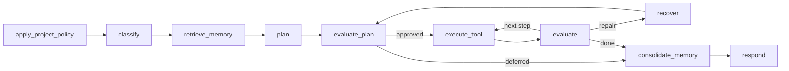

# NetZoo Agent Code Reading Guide

This guide is for readers who know basic Python but are not yet familiar with
LangGraph or NetZoo. The goal is not to read every file at once, but to build
one stable mental path first: **how the CLI receives a sentence, how the graph
schedules nodes, how typed state flows between them, and which adapter finally
runs a tool and produces the reply.**

For the full architecture and design rationale, read
[`NETZOO_HARNESS_ARCHITECTURE.md`](NETZOO_HARNESS_ARCHITECTURE.md).

## Four things to know before you start

1. The **Router** classifies natural language into a `TaskDecision`; it never
   runs a shell command.
2. The **Planner** turns a decision into a `WorkflowPlan`; the **Plan
   Evaluator** is the safety gate in front of the Executor.
3. Think of **LangGraph** as "a flowchart that uses the current state to decide
   which Python function runs next".
4. `scripts/netzoo_agent.py` is a compatibility facade for the old entry point;
   the real behavior usually lives in an owner module under
   `scripts/netzoo_agent_core/`.

Skip the Pydantic, LangChain, and Network Zoo details on the first pass. Track
only three questions:

- Which node am I in?
- What does this node read from state, and what does it write back?
- Which owner module does the real decision or I/O get delegated to?

## The 15-minute main path

Read the files below in order; for each, only look at the parts named.

### 1. Compatibility entry point (1 minute)

Read `scripts/netzoo_agent.py`.

Only look at which implementation modules it imports and how it hands the CLI
over to the core. A test caps this file at 150 lines; do not add new features
to it.

### 2. CLI coordination (1 minute)

Read `run_cli()` in `scripts/netzoo_agent_core/cli/loop.py`.

It does five things: configure the runtime, handle immediate commands, start
memory, load the policy, and enter the conversation. Argument parsing is in
`cli/arguments.py`; `--policy-status`, memory, and preflight commands are in
`cli/commands.py`; dependency wiring is in `cli/bootstrap.py`.

### 3. One conversation turn (2 minutes)

Read `run_conversation()` in `scripts/netzoo_agent_core/cli/conversation.py`.

Look only for:

- `HumanMessage(content=task)`: the user's text enters the graph.
- `invoke_graph_turn_func(...)`: runs one graph turn.
- `WorkflowPlan.model_validate(result["plan"])`: decides whether more data or a
  preference confirmation is needed.
- `save_session(...)`: saves resumable state.

Clarification and follow-up handling live in `cli/clarification.py` and
`cli/follow_up.py`; skip them on the first pass.

### 4. The whole flowchart (2 minutes)

Read `compile_graph()` in `scripts/netzoo_agent_core/graph/topology.py`.

This is the most important map: node names, fixed edges, and conditional edges
are all defined here.



Conditional routing (`route_plan_evaluation`, `route_evaluation`) is in
`graph/transitions.py`.

### 5. Router and Planner nodes (2 minutes)

Read `scripts/netzoo_agent_core/graph/routing_planning.py`.

- `classify_task()` produces a `TaskDecision`; there is a deterministic fallback
  when the model fails.
- `plan_task()` hands the decision to the real Planner and writes the plan back
  to state.

Then read `scripts/netzoo_agent_core/planning/builder.py`, the plan-building
entry point. Evidence, assembly, and rendering live in sibling modules in the
same folder; you do not need to expand them yet.

### 6. The gate before the Executor (2 minutes)

Read `scripts/netzoo_agent_core/evaluation/plan_review.py`.

It checks that a `WorkflowPlan` matches its workflow, required inputs, step
order, and policy. The concrete rules are in `evaluation/plan_rules.py`. If a
plan is rejected, start from these two owners; do not change graph edges.

### 7. Execution and result evaluation (2 minutes)

First read `scripts/netzoo_agent_core/graph/execution.py` to understand four
graph nodes:

- `evaluate_plan`
- `execute_tool`
- `evaluate_result`
- `recover`

Then read `scripts/netzoo_agent_core/execution.py`, which turns an approved step
into a PANDA, PUMA, LIONESS, CONDOR, or other adapter call. The decorated
LangChain tools are in `scripts/netzoo_agent_core/tool_adapters.py`; pure data
validation does not belong in this layer. `execution.py` is close to its
1000-line cap, so the BONOBO and LIONESS-DRAGON runners live in
`execution_bonobo.py` and `execution_lioness_dragon.py` and are imported and
registered by `execution.py`.

### 8. The reply (1 minute)

Read `scripts/netzoo_agent_core/graph/response.py`.

It combines the plan, tool result, evaluation, and memory context into the
answer the user sees. If only the displayed text or its language is wrong, look
next in `presentation.py` and `evaluation/rendering.py`.

Every deterministic reply also carries a `reply_kind`.
`scripts/netzoo_agent_core/reply_cards/` derives a "card" from the same decision
(conclusion, key points, options, related items that cannot run, next step);
cards affect display only. When the user picks an option, `engine/choices.py`
turns it into text the machine already accepts; the terminal rendering is in
`cli/terminal_cards.py`.

### 9. Memory and data, on the second pass (2 minutes)

- `scripts/netzoo_agent_core/memory/episodes.py`: episode search, retention, and
  writes.
- `scripts/netzoo_agent_core/memory/profiles.py`: long-term preferences that
  require confirmation.
- `scripts/netzoo_agent_core/memory/storage.py`: JSON persistence and
  serialization.
- `scripts/netzoo_agent_core/data/tables.py`: pure table and biological ID
  validation.
- `scripts/netzoo_agent_core/data/transforms.py`: pure expression and
  co-expression transforms.
- `scripts/netzoo_agent_core/data/discovery.py`: candidate-file keywords,
  scoring, and selection.

`data/table_validation.py` and `data/preparation.py` are compatibility facades
for old imports; change the real logic in the owner modules above.

## Tracing state with one PANDA request

Use this request as a fixed example while reading:

```text
Run PANDA using data/expression.tsv, data/motif.tsv, and data/ppi.tsv; write outputs/panda.tsv.
```

Data flows roughly through these types:

| Stage | Main data | Question to answer |
|---|---|---|
| CLI | `HumanMessage` | How does the raw request enter `messages`? |
| Router | `TaskDecision` | Is the action PANDA? Which path fields were extracted? |
| Planner | `WorkflowPlan` | Is the evidence complete? What are the steps and outputs? |
| Plan Evaluator | `PlanEvaluationResult` | Do required inputs, policy, and order pass? |
| Executor | `ToolExecutionResult` | What was the real or dry-run command, stdout, and artifact? |
| Result Evaluator | `EvaluationResult` | Next step, done, failed, or recovery? |
| Memory | profile, episodes | Which confirmed preferences or reusable outcomes apply? |
| Response | messages | How is the structured result turned into final text? |

Type definitions live in `scripts/netzoo_agent_core/contracts/`:

- `contracts/decisions.py`: Router and task decisions
- `contracts/planning.py`: evidence, steps, plan
- `contracts/results.py`: plan, tool, and result evaluations
- `contracts/state.py`: the full `AgentState`
- `contracts/memory.py`: profile and episode schemas

In each graph node, look for `return {...}`; those keys are the fields the node
writes back to state.

## Symptom-to-owner map

| Symptom or need | Start here | Then look at |
|---|---|---|
| CLI flag has no effect, wrong exit code | `cli/commands.py`, `cli/loop.py` | `cli/arguments.py`, `cli/bootstrap.py` |
| Interaction, resume, or data clarification gets stuck | `cli/conversation.py` | `cli/clarification.py`, `session.py` |
| Router picks the wrong workflow | `graph/routing_planning.py` | `routing/`, `interpretation/hydration.py` |
| Discovery picks the wrong file | `data/discovery.py` | `interpretation/discovery.py`, `routing/discovery.py` |
| Plan is missing a step or evidence | `planning/builder.py` | `planning/assembly.py`, `planning/evidence.py` |
| Plan is wrongly rejected | `evaluation/plan_review.py` | `evaluation/plan_rules.py`, `workflows/*.yaml` |
| Graph jumps to the wrong node | `graph/topology.py` | `graph/transitions.py` |
| Wrong tool parameters or command | `execution.py` | `tool_adapters.py`, `command.py` |
| Wrong delimiter, IDs, or table orientation | `data/tables.py` | `data/inspection.py`, `scripts/netzoo_table_io.py` |
| Wrong expression transform | `data/transforms.py` | `data/preparation.py` (compatibility facade only) |
| Wrong output path or artifact | `data/paths.py`, `data/artifacts.py` | `execution.py` |
| Preference was not saved | `memory/profiles.py` | `memory/storage.py`, `graph/policy_memory.py` |
| Episode search or cleanup is wrong | `memory/episodes.py` | `memory/normalization.py`, `memory/storage.py` |
| Final text or language is wrong | `graph/response.py` | `presentation.py`, `evaluation/rendering.py` |
| Options, key-point cards, or next step are wrong | `reply_cards/builder.py` | `reply_cards/choices.py`, `engine/choices.py` |
| Session name, notes, tags, model, or output folder | `session_meta.py`, `session_outputs.py` | `server/history.py`, `server/app.py` |
| Outputs tab grouped by session (order, ownership) | `outputs_by_session` in `server/history.py` | `server/files.py`, `desktop/src/features/files/OutputsBySession.tsx` |

## Common changes

### Add a CLI command

1. Define the argument in `cli/arguments.py`.
2. Implement an immediate command in `cli/commands.py`, or the behavior in the
   appropriate owner.
3. Keep `cli/loop.py` to coordination only; do not push command details back
   into it.
4. Add a CLI lifecycle test covering one-shot, interactive, and exit codes.

### Change an existing workflow rule

1. Start with `scripts/workflow_registry.py` and the matching `workflows/*.yaml`.
2. Check how `planning/` produces the steps.
3. Check how `evaluation/plan_review.py` reviews them.
4. Change `execution.py` only if the execution parameters really change.

### Add pure data validation or a transform

1. Put it in `data/tables.py`, `data/transforms.py`, or a new sibling owner.
2. Pass parameters explicitly; the pure data layer must not read CLI or
   LangGraph state.
3. If you need a `@tool`, wrap the pure function in `tool_adapters.py`.
4. Never let `data/` import `graph`, `planning`, `execution`, or
   `tool_adapters`.

### Change memory

1. Start with the schema in `contracts/memory.py`.
2. Profile behavior is in `memory/profiles.py`; episode behavior is in
   `memory/episodes.py`.
3. Shared normalization goes in `memory/normalization.py`; file I/O goes in
   `memory/storage.py`.
4. Keep the public `from netzoo_agent_core.memory import ...` interface intact.

## Safe to skip on the first pass

- Re-export details in `__init__.py`.
- Compatibility facades such as `validation.py`, `preparation.py`, and
  `bundles.py`.
- The full tracing, pricing, and token-accounting implementation.
- Every individual biological table validation rule.
- Provider fallback and all error wording.
- The full contents of test fixtures.

Finish the main path first, then come back to an owner when a real problem
points there; do not read the folders file by file from top to bottom.

## Practical reading tips

Find node definitions and their tests by name:

```bash
rg -n 'def (classify_task|plan_task|execute_tool|evaluate_result)' scripts tests
```

Trace where a typed contract is produced and consumed:

```bash
rg -n 'WorkflowPlan|PlanEvaluationResult|ToolExecutionResult' scripts/netzoo_agent_core tests
```

Run only the tests closest to the owner you are changing:

```bash
python -m pytest tests/test_cli_lifecycle.py -q
python -m pytest tests/test_memory_package.py -q
python -m pytest tests/test_data_package.py -q
python -m pytest tests/test_agent_module_boundaries.py -q
```

Find the real source behind an old facade:

```bash
rg -n '^from .* import|^__all__' scripts/netzoo_agent_core/data/table_validation.py
```

Full regression:

```bash
python -m pytest -q
python -m compileall -q scripts
```

## Glossary

| Term | Meaning in this project |
|---|---|
| module | A Python file or package with one clear responsibility. |
| interface | The small set of public functions, classes, or typed contracts other modules should depend on. |
| seam | A responsibility boundary that can be tested or replaced on its own, such as the `WorkflowPlan` between the Planner and the Plan Evaluator. |
| adapter | A thin layer that reshapes core data for an external framework, the CLI, a file, or a command. |
| Router | The stage that understands the request and produces a `TaskDecision`. |
| Planner | The stage that combines the decision and evidence into a `WorkflowPlan`. |
| Plan Evaluator | The gate before the Executor that rejects unsafe or incomplete plans. |
| Executor | The stage that runs approved workflow steps. |
| Result Evaluator | Decides whether a step result means continue, done, failed, or recovery. |
| Graph state | `AgentState`, the typed working state every LangGraph node reads and writes. |
| episode memory | A compact summary of one task's outcome, used for later retrieval; not a full chat log. |

The one navigation rule: **read `graph/topology.py` to find the stage, then
follow the typed state to the owner module; never patch a facade or the raw
output of a repository-wide search.**
