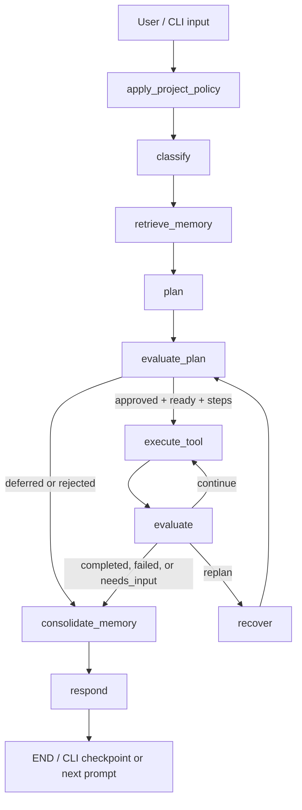

# NetZoo Agent Architecture and Implementation Guide

This document describes the NetZoo agent's capabilities, code layers, and data
contracts, and how one user request passes through the Router, Planner, Plan
Evaluator, Executor, Result Evaluator, Memory, and CLI. After reading it you
should be able to answer:

- How does a natural-language request become an executable, auditable workflow?
- How is the Planner's plan handed to the Plan Evaluator?
- How does the Plan Evaluator guarantee that the Executor cannot bypass required
  inputs, the allowlist, or step order?
- How does the Executor's text output become a typed result for the Result
  Evaluator?
- How are missing inputs, preference confirmation, dry runs, failures, and
  recovery handled?
- What is each Python module responsible for, and what must change when a
  workflow is added?

If this is your first time in the code, start with the 15-minute main path in
[`CODE_READING_GUIDE.md`](CODE_READING_GUIDE.md); use this document to look up
the full design, data contracts, and governance details.

---

## 1. What the system is

The system is a rule-constrained, stateful, resumable NetZoo workflow harness
with governed long-term memory. It integrates these workflows:

- PANDA, PUMA
- LIONESS-PANDA, LIONESS-PUMA, LIONESS co-expression
- CONDOR, COBRA, SAMBAR, OTTER, GIRAFFE, BONOBO
- DRAGON, LIONESS-DRAGON

plus expression formatting and co-expression conversion helpers, an official
STRING network download (`download_string`), Context7 documentation lookup, and
web search.

It does not let an LLM choose shell commands freely. The LLM mainly reads the
user's intent and writes general prose answers; all local tool authority,
required inputs, step sequences, input validation, output safety, and recovery
are enforced by Python typed contracts and allowlists.

The Planner, Plan Evaluator, Executor, and Result Evaluator are nodes with
separate responsibilities in one LangGraph, not four independently launched LLM
sub-agents talking to each other. This keeps the (mostly linear) NetZoo
workflows reproducible, cheaper, and easier to test.

---

## 2. File layout

`scripts/netzoo_agent.py` used to hold the data models, routing, planning, I/O,
execution, evaluation, memory, session, and CLI in one file. It is now a
compatibility entry point capped at 150 lines; the implementation lives in
`scripts/netzoo_agent_core/`, layered as contracts, data, workflow, and
interfaces.

```text
scripts/
├── netzoo_agent.py                  # legacy CLI/import compatibility facade
├── workflow_registry.py             # single Python registry of actions and workflows
├── netzoo_table_io.py               # shared table reading and delimiter detection
└── netzoo_agent_core/
    ├── __init__.py                  # small public interface for new code
    ├── contracts/                   # typed contracts; __init__ keeps the old import interface
    │   ├── decisions.py             # Router, task, and preference decisions
    │   ├── planning.py              # evidence, workflow steps, and plan
    │   ├── results.py               # plan/tool/result evaluation contracts
    │   ├── policy.py                # project policy contracts
    │   ├── memory.py                # profile and episode contracts
    │   └── state.py                 # LangGraph AgentState
    ├── settings.py                  # constants and process-wide runtime settings
    ├── framework_compat.py          # LangChain/LangGraph optional-dependency bridge
    ├── presentation.py              # shared language and display policy
    ├── data/                        # data layer, independent of orchestration
    │   ├── paths.py                 # output path safety and canonicalization
    │   ├── tables.py                # pure table and biological ID validation
    │   ├── transforms.py            # pure expression/co-expression transforms
    │   ├── discovery.py             # candidate-file keywords, scoring, and selection
    │   ├── inspection.py            # neutral input inspection
    │   ├── bundles.py               # PANDA/PUMA input bundles
    │   └── artifacts.py             # output artifact validation
    ├── tool_adapters.py             # LangChain @tool wrappers around pure data functions
    ├── validation.py                # legacy import facade -> data/tables
    ├── preparation.py               # legacy import facade -> data/transforms
    ├── bundles.py                   # legacy import facade -> data.bundles
    ├── artifact_validation.py       # legacy import facade -> data.artifacts
    ├── path_safety.py               # legacy import facade -> data.paths
    ├── runtime.py                   # bridge for legacy process-wide settings
    ├── memory/                      # long-term memory interface and implementation
    │   ├── profiles.py              # confirmed UserProfile behavior
    │   ├── episodes.py              # episode search, retention, and writes
    │   ├── normalization.py         # shared text and query normalization
    │   └── storage.py               # JSON persistence and serialization
    ├── command.py                   # subprocess and dry-run command rendering
    ├── execution.py                 # workflow adapters and LOCAL_TOOL_EXECUTORS
    ├── execution_bonobo.py          # BONOBO runner (split out of execution.py)
    ├── execution_lioness_dragon.py  # LIONESS-DRAGON runner (split out of execution.py)
    ├── routing/                     # capability gate, outcome matching, dispatch, result normalization
    ├── policy.py                    # fail-closed loader for AGENTS.md and workflow YAML
    ├── interpretation/              # deterministic hydration, repair, file discovery
    ├── planning/                    # evidence ledger and WorkflowPlan construction
    ├── evaluation/                  # Plan Evaluator, Result Evaluator, recovery, rendering
    ├── llm.py                       # prompts, model allowlist, token budget
    ├── graph/                       # LangGraph nodes, edges, transitions, orchestration
    ├── engine/                      # driver-independent conversation engine (CLI and desktop UI)
    ├── reply_cards/                 # display-only reply cards derived from the typed decision
    ├── server/                      # local daemon serving the engine to the desktop UI
    ├── session.py                   # resumable sessions and retention
    ├── interaction.py               # legacy import facade -> cli submodules
    └── cli/                         # CLI interface and lifecycle
        ├── arguments.py             # argument definitions
        ├── commands.py              # immediate policy/memory/preflight commands
        ├── bootstrap.py             # runtime dependency wiring
        ├── conversation.py          # one-shot, interactive, and resume lifecycle
        ├── slash_commands.py        # /planning, /test, /execute, /status, /help, /doctor
        └── loop.py                  # small CLI coordinator
```

The split is not "one function per file". Each module hides one complete
behavior and exposes a small, clear interface, for example:

- `planning.build_workflow_plan(...) -> WorkflowPlan`
- `evaluation.evaluate_workflow_plan(...) -> PlanEvaluationResult`
- `evaluation.evaluate_step_result(...) -> EvaluationResult`
- `graph.build_graph(...) -> compiled LangGraph`

These are the main seams, and the interfaces that tests and other callers
should prefer.

### 2.1 Where to look first

| Symptom or goal | First place to read | Next layer |
|---|---|---|
| Wrong CLI argument, interaction flow, or confirmation question | `cli/` | `cli/arguments.py`, `cli/commands.py`, `cli/conversation.py` |
| Router picks the wrong capability or tool | `routing/` | `interpretation/`, `planning/` |
| Missing inputs, rejected plan, or wrong step order | `planning/`, `evaluation/plan_rules.py` | `contracts/planning.py` |
| Wrong input file, delimiter, ID, or output-path validation | `data/` | `data/tables.py`, `data/paths.py`, `data/discovery.py` |
| A workflow command fails | `execution.py` | `command.py`, `data/bundles.py` |
| Graph jumps to the wrong node or recovery misbehaves | `graph/topology.py`, `graph/transitions.py` | `evaluation/recovery.py` |
| Wrong reply language or formatting | `presentation.py` | `evaluation/rendering.py`, `graph/response.py` |
| Type, serialization, or state-field problems | `contracts/` | the matching decisions/planning/results/state module |

`contracts/__init__.py`, `data/__init__.py`, `cli/__init__.py`, and the legacy
facades above are stable compatibility layers. Change behavior in the owner
module listed in the table; never put new logic back into a facade.

### 2.2 Compatibility entry points and interactive execution

These preview and status commands remain available:

```bash
python scripts/netzoo_agent.py --policy-status
python scripts/netzoo_agent.py --task "Run a PANDA demo"
./netzoo-chat
```

`--task` is preview-only; the old `--execute` startup argument has been removed
and argparse rejects it. Execution happens only inside an interactive session:
after a plan has been previewed and approved, the user enters `/execute` and
confirms, which authorizes exactly one graph turn to run that plan. The session
then returns to Planning mode. `/planning` switches to preview-only Planning
mode; `/test` switches to Synthetic Test mode (still preview-only until
`/execute`, with unresolved gene labels accepted as test-only identifiers).

Existing code that does `import netzoo_agent` keeps working. The facade
re-exports the old names and keeps a few process-wide settings in sync only for
old tests and callers. New code should import the owning module directly:

```python
from netzoo_agent_core.planning import build_workflow_plan
from netzoo_agent_core.evaluation import evaluate_workflow_plan
```

---

## 3. Lifecycle of one request



LangGraph state is `AgentState` (`contracts/state.py`). The main fields:

| State field | Typed value | Purpose |
|---|---|---|
| `messages` | LangChain messages | this turn's input and reply |
| `decision` | serialized `TaskDecision` | internal decision after the Router and deterministic hydration |
| `plan` | serialized `WorkflowPlan` | the Planner's only structured output |
| `plan_evaluation` | serialized `PlanEvaluationResult` | the gate verdict before the Executor |
| `current_step` | integer | index of the next `WorkflowStep` |
| `tool_result` | serialized `ToolExecutionResult` | the most recent execution result |
| `tool_results` | list | all results so far in this workflow |
| `evaluation` | serialized `EvaluationResult` | the Result Evaluator's control result |
| `replan_count` | integer | bounded recovery count |
| `profile` | serialized `UserProfile` | confirmed long-term preferences |
| `retrieved_episodes` | list of `Episode` | compact past outcomes retrieved this turn |
| `project_policy` | serialized `ProjectPolicySnapshot` | validated policy and its hash |
| `token_usage` | serialized `LLMUsage` | Router/response token telemetry |

`AgentState` also carries routing and conversation context added later
(`semantic_goal`, `requested_outcome`, `capability_match`,
`request_requirements`, `task_state`, `workflow_continuation`,
`method_comparison`, `reply_kind`, `previewed_inputs`, and others); see
`contracts/state.py` for the full list.

---

## 4. Phase 1: project policy

### 4.1 Policy sources

Authority and specification come in three layers:

1. `scripts/workflow_registry.py`
   - Python action allowlist
   - required and optional inputs
   - validation steps
   - executor arguments
   - workflow name
   - memory metadata
2. `workflows/*.yaml`
   - human-readable, verifiable workflow specifications
3. `AGENTS.md`
   - cross-workflow conventions and the workflow spec directory

The Python registry is the source of truth for execution authority. YAML and
Markdown may only describe or narrow behavior; they cannot add an action, remove
a required input, or bypass the per-session `/execute` confirmation.

### 4.2 Fail-closed validation in the loader

`ProjectPolicyLoader.load()`:

1. Finds `AGENTS.md`.
2. Parses only the schema-constrained YAML front matter.
3. Checks `policy_version == 2`.
4. Confirms the workflow directory is inside the project.
5. Reads every workflow YAML.
6. Checks that the set of actions exactly equals Python `RUN_ACTIONS`.
7. Checks that required inputs, validation steps, the execution step, and the
   output capability exactly match the Python registry, and that every
   `input_checks` entry quotes the workflow's own contract.
8. Produces an immutable `ProjectPolicySnapshot` and a SHA-256 `policy_hash`.

Any conflict raises `ProjectPolicyError` and the agent refuses to start. The
Markdown body of `AGENTS.md` is never sent to the model, so explanatory prose
cannot become a runtime instruction.

The graph's `apply_project_policy` node writes the snapshot's `model_dump()`
into state.

---

## 5. Phase 2: routing and deterministic hydration

### 5.1 LLM-facing schema

The Router outputs a small `RouterDecision` (`contracts/decisions.py`) with
fields such as:

```text
action
selected_action
candidate_actions
in_scope
intent_type
confidence
reason
semantic_goal
clarification_question
outcome_hypotheses
```

The Router does not get trusted paths, missing-input lists, or preference-write
authority. A small schema shrinks the attack surface of LLM output and its
token use.

### 5.2 Internal TaskDecision

The Router result passes through, in order:

1. `hydrate_router_decision` (`interpretation/hydration.py`)
   - Deterministically parses paths, queries, and preference proposals from the
     latest user task.
   - Accepts the Router's typed `RequestedOutcome`, but never a workflow list
     from the Router.
2. `match_requested_outcome` (`routing/requested_outcome_matching.py`)
   - Compares operation, artifact type, entity/role, and granularity against
     the Python `OutputCapabilityDefinition`s.
   - The result can only be `exact`, `ambiguous`, or `unsupported`.
   - A YAML `output_capability` must exactly match the Python registry, or the
     policy loader fails closed.
3. `repair_router_decision` (`interpretation/repair.py`)
   - Only an exact match can create code-owned `matched_actions`.
   - `recommended_actions` is a workflow sequence used for explanation;
     `alternative_actions` is only for describing capability gaps and never
     grants authority.
   - Distinguishes "asking how to do it" from "authorizing it now".
4. `enforce_capability_gate` (`routing/capability.py`)
   - A local run action must be in `matched_actions`; scope, confidence,
     required fields, and capability are then checked.
5. On provider failure, a conservative `deterministic_router_fallback`
   (`interpretation/provider_fallback.py`) is used. It only accepts an explicit
   workflow name and never guesses a workflow from an unnamed scientific goal.

The authority data flow:

```text
Router RequestedOutcome
    -> Pydantic validation
    -> Python OutputCapabilityDefinition matcher
    -> exact / ambiguous / unsupported
    -> repair_router_decision + enforce_capability_gate
    -> Planner only for exact matched actions
```

Only the full `TaskDecision` contains:

- `should_execute`
- `missing_inputs`
- every input and output path
- formatting parameters
- docs and web queries
- preference proposals
- the requested outcome
- the capability match status
- exact matched actions, the guidance sequence, and non-authorizing
  alternatives

### 5.3 What the Router sees

The Router reads only the latest human turn, not the unbounded history. A
pending workflow passes the necessary context back through canonical
continuation markers, for example:

- `PREVIOUS_ACTION=...`
- `SELECTED_FIELD=...`

This keeps old conversation from disturbing the current classification and
lets clarifications be verified deterministically.

---

## 6. Phase 3: memory retrieval

The `retrieve_memory` node runs after `classify` and before `plan`:

1. `UserProfileStore.load(profile_id)` loads confirmed preferences.
2. `EpisodeStore.search(profile_id, user_task, limit=3)` returns at most three
   relevant episodes.
3. Both are serialized into graph state.

### 6.1 UserProfileStore

Only these keys can be stored:

- `default_output_dir`
- `allow_demo_autofill`
- `reuse_last_inputs`
- `preferred_workflow`

A preference must be stated explicitly by the user; the Planner first enters
`needs_confirmation`, and the CLI then asks for `yes`. A proposal itself has no
write authority. Every profile read re-validates that:

- the output directory is inside the project's `outputs/`;
- the workflow is on the allowlist;
- booleans normalize unambiguously;
- unknown preference keys are rejected.

### 6.2 EpisodeStore

An episode is a compact outcome of a past task, not a full conversation or
dataset:

- workflow, action, intent, status
- input and output roles used
- validation and execution steps
- execution mode
- artifacts, metrics, error signature
- recovery actions
- policy hash

It never stores dataset contents or full stdout. Episodes are partitioned per
profile, with file locks, atomic writes, private permissions, retention, and
count and size limits.

Only when the user has confirmed `reuse_last_inputs=true` may the Planner reuse
inputs from a successful episode of the same workflow, and it still re-checks
that the files exist and that identifiers are compatible.

---

## 7. Phase 4: how the Planner builds a WorkflowPlan

The graph's `plan_task` node:

```python
decision = TaskDecision.model_validate(state["decision"])
plan = build_workflow_plan(
    decision,
    user_task,
    profile=state.get("profile"),
    retrieved_episodes=state.get("retrieved_episodes", []),
    project_policy=state.get("project_policy"),
)
```

`build_workflow_plan` returns a `WorkflowPlan`; the graph stores only its
`model_dump()` in state.

### 7.1 WorkflowPlan contract

| Field | Meaning |
|---|---|
| `workflow` | human-readable workflow name |
| `objective` | the accepted goal for this turn and why |
| `decision` | the full `TaskDecision` snapshot after Planner repair |
| `evidence` | provenance ledger for every required field |
| `input_bundle_options` | candidate dataset bundles offered for selection |
| `steps` | ordered typed `WorkflowStep`s |
| `missing_inputs` | required fields still unresolved |
| `status` | `ready`, `needs_input`, `needs_confirmation`, or `respond_only` |
| `question` | the single question when human input is needed |
| `workflow_handoff` | declared handoff to a follow-on workflow, if any |
| `preference_proposals` | long-term preferences not yet confirmed |
| `memory_notes` | notes on the profile and episodes used |
| `policy_hash` | the active policy hash when the plan was built |
| `policy_notes` | conventions from the validated workflow spec |
| `recovery_*` | recovery action, error code, step index, and attempt count |

A `WorkflowStep` contains only:

- `action`
- `purpose`
- `arguments`

The Planner cannot insert an arbitrary shell command; every step action is
checked again against the allowlist by the Plan Evaluator.

### 7.2 Evidence ledger

Every required field must have one `InputEvidence` entry:

| Status | Provenance contract |
|---|---|
| `provided` | the path literal appears in the user's task |
| `selected` | the user explicitly chose it from clarification candidates |
| `discovered` | the Planner found a clear best candidate in the same dataset/workspace and recorded why |
| `derived` | produced from another input by a declared step (`derived_from` names the source) |
| `demo_bundle` | the user explicitly asked for a demo/test and a complete, compatible bundle was found |
| `defaulted` | only for reversible output locations, never for research inputs |
| `missing` | no safe, unique value was found |

Evidence also stores:

- `field`
- `value`
- `reason`
- up to five `candidates`
- bundle identifiers when a dataset bundle was used

The ledger is not just display text: the Plan Evaluator checks, field by field,
that each status satisfies its provenance contract.

### 7.3 Planner resolution order

For each required field, the Planner tries, in order:

1. A path explicitly named in the user's task.
2. A Router path, trusted only if the literal actually appears in the task.
3. A valid successful episode of the same workflow, if the user confirmed
   `reuse_last_inputs=true`.
4. A coherent demo bundle, for an explicit demo/test request.
5. A search of the dataset directory near the expression file and of the
   project's `data/`.
6. Automatic selection only when one candidate clearly scores best.
7. Otherwise, `missing`.

A workspace path guessed by the Router that does not appear in the user's task
is cleared by the Planner; it can never pass as `provided`.

### 7.4 Output defaults

Outputs are reversible choices and may be defaulted safely (for example the
PANDA/PUMA network output, LIONESS aggregate and sample-specific outputs, or the
CONDOR output directory). Without an explicit path, outputs go to the current
session's own output folder.

An input dataset is never defaulted just because toy data happens to be in the
workspace. A request about a real data folder without a concrete path never
silently switches to a demo bundle.

### 7.5 Missing inputs and human-in-the-loop

If any required field is `missing`:

- `decision.should_execute = False`
- `plan.status = "needs_input"`
- `plan.steps = []`
- the CLI saves a session checkpoint
- the clarification wizard handles one field at a time, and the user supplies
  each missing input in turn

Answers become a canonical continuation and run again through the Router,
Planner, and Plan Evaluator; the old plan is never patched and sent straight to
the Executor.

### 7.6 Preference confirmation

If there are unconfirmed preference proposals:

- `plan.status = "needs_confirmation"`
- `plan.steps = []`
- the Executor does not run
- the CLI calls `UserProfileStore.confirm` only after an explicit `yes`

### 7.7 Step sequence of a ready plan

The step sequence comes from the active workflow spec, falling back to the
Python registry only when there is no snapshot.

| Workflow | Typed steps |
|---|---|
| PANDA | `inspect_inputs -> run_panda` |
| PUMA | `inspect_inputs -> run_puma` |
| LIONESS-PANDA | `inspect_inputs -> run_lioness_panda` |
| LIONESS-PUMA | `inspect_inputs -> run_lioness_puma` |
| LIONESS co-expression | `run_lioness_coexpression` |
| CONDOR | `inspect_condor_inputs -> run_condor` |
| COBRA | `inspect_cobra_inputs -> run_cobra` |
| SAMBAR | `inspect_sambar_inputs -> run_sambar` |
| DRAGON | `inspect_dragon_inputs -> run_dragon` |
| LIONESS-DRAGON | `inspect_dragon_inputs -> run_lioness_dragon` |
| OTTER | `inspect_otter_inputs -> run_otter` |
| GIRAFFE | `inspect_giraffe_inputs -> run_giraffe` |
| BONOBO | `inspect_bonobo_inputs -> run_bonobo` |
| Expression formatting | `format_expression` |
| Co-expression conversion | `convert_expression` |
| STRING download | `download_string` |
| Context7 | `query_context7` |
| Web search | `web_search` |

Writing these steps does not grant execution; the next node must still review
the plan.

---

## 8. How the Planner hands the plan to the Plan Evaluator

This is the most important seam in the system.

### 8.1 What is passed is not Markdown

The Planner returns:

```python
{
    "plan": plan.model_dump(),
    "decision": plan.decision,
    "current_step": 0,
    "tool_results": [],
    "replan_count": 0,
}
```

The next node, `evaluate_plan`, re-validates it:

```python
plan = WorkflowPlan.model_validate(state["plan"])
evaluation = evaluate_workflow_plan(
    plan,
    latest_user_task,
    state.get("project_policy"),
)
```

So the evaluator receives a Pydantic-validated `WorkflowPlan`, the original
user task, and the active policy snapshot. The text produced by
`render_plan(plan)` is for human audit only; the Evaluator never parses it.

### 8.2 PlanEvaluationResult

The Plan Evaluator returns:

```text
status: approved | deferred | rejected
score: 0..100
summary
rubric: list[PlanRubricItem]
```

Each `PlanRubricItem`:

```text
criterion
required
result: pass | fail | not_applicable
detail
```

### 8.3 Code-enforced criteria

The core criteria (`evaluation/plan_review.py`, rules in
`evaluation/plan_rules.py`):

| Criterion | Enforced check |
|---|---|
| `intent_and_capability_alignment` | action, workflow, intent, and user authorization agree |
| `required_input_evidence` | every required input/output has consistent, non-missing evidence |
| `evidence_provenance_contract` | provided/selected/discovered/derived/demo/defaulted statuses meet their provenance contracts |
| `dataset_bundle_provenance` | autonomously discovered multi-file inputs come from one dataset bundle |
| `path_hygiene` | paths contain no parsing artifacts such as trailing punctuation |
| `step_allowlist` | every step action is on the Python allowlist |
| `validation_and_execution_order` | the steps exactly equal the active workflow spec |
| `step_argument_alignment` | every step uses the typed arguments reviewed in the plan |
| `output_non_overwrite` | no output overwrites any input |
| `output_role_uniqueness` | every populated output role resolves to a distinct path |
| `planner_state_consistency` | `ready`, `should_execute`, `missing_inputs`, and steps agree |
| `project_policy_binding` | the plan's policy hash equals the active validated policy hash |

Further criteria apply when relevant: `operation_authorization` (the request
does not forbid a planned operation), `capability_verdict`,
`request_requirements`, `execution_readiness`, `decision_schema`,
`workflow_handoff_contract`, `recovery_authorization`,
`string_acquisition_contract`, and the CONDOR/COBRA derived-output safety
checks.

If the plan is not yet `ready`, the verdict is `deferred` and nothing runs. If
any required criterion is `fail`, the verdict is `rejected`. The score is an
audit summary and never overrides a required failure.

### 8.4 The Executor condition that cannot be bypassed

The graph's conditional edge (`graph/transitions.py`) leads to the Executor
only when all three hold:

```python
evaluation.status == "approved"
and plan.status == "ready"
and bool(plan.steps)
```

Every other case goes to `consolidate_memory -> respond`. Therefore:

- The Planner cannot approve its own plan.
- Markdown that says "approved" has no effect.
- An LLM response cannot add a step.
- A rejected or deferred plan never reaches the Executor.

---

## 9. Phase 5: the Executor

The `execute_tool` node runs one `WorkflowStep` at a time:

1. Rebuilds the `WorkflowPlan` from state.
2. Reads `steps[current_step]`.
3. Rebuilds the `TaskDecision` from `plan.decision`.
4. Temporarily sets `decision.action` to this step's action.
5. Applies the allow-listed `step.arguments`.
6. Calls `execute_selected_tool(decision)` (`routing/dispatch.py`).
7. Normalizes the legacy text output with `structure_tool_result`
   (`routing/results.py`).
8. Writes the typed result to `tool_result` and appends it to `tool_results`.

### 9.1 Tool dispatch

The local executor mapping is `LOCAL_TOOL_EXECUTORS` in `execution.py`. It maps
every `inspect_*`, `run_*`, `format_expression`, `convert_expression`, and
`download_string` action to its adapter. `query_context7` and `web_search` are
dispatched to the read-only retrieval functions in `routing/retrieval.py`.

`workflow_registry.executor_arguments(...)` decides which fields each action
receives; extra fields are never passed through to an adapter.

### 9.2 Dry run and execute mode

By default `EXECUTE_TOOLS=False`:

- parsing, planning, evaluation, and input validation still run;
- run steps only produce a command preview;
- no analysis command is executed;
- `ToolExecutionResult.status = "dry_run"`.

A subprocess runs only after the user enters `/execute` in the current
`./netzoo-chat` session and confirms. That authority covers one graph turn for
the previewed plan; `EXECUTE_TOOLS` is reset to `False` afterwards. If a
previewed input file changed since the preview, the run is refused.

### 9.3 Input validation

`data/tables.py` (re-exported by the `validation.py` facade), the per-workflow
`inspect_*` adapters, and `scripts/netzoo_table_io.py` handle:

- delimiter and annotation-row detection
- expression orientation
- numeric column checks
- duplicate and empty identifier checks
- overlap of motif target genes with expression genes
- overlap of motif TFs with PPI TFs
- miRNA list format
- overlap of miRNA names with motif/prior regulators
- CONDOR bipartite edge format and numeric weights

LIONESS adapters also check the expression sample count, header requirements,
and output paths.

### 9.4 ToolExecutionResult

Only this stable contract passes between the Executor and the Result
Evaluator:

| Field | Purpose |
|---|---|
| `action` | the typed action actually run |
| `status` | `success`, `dry_run`, or `failed` |
| `summary` | short machine-readable result summary |
| `attempt_id`, `superseded` | attempt bookkeeping when a step is re-run |
| `artifacts` | expected outputs |
| `metrics` | exit code, verified artifacts, and similar |
| `warnings` | normalized warnings |
| `errors` | normalized errors |
| `error_code` | stable error code, when one applies |
| `retryable` | whether bounded recovery is allowed |
| `recovery_hint` | allow-listed recovery name |
| `log_file` | full raw output log |
| `raw_output` | length-capped output |

If raw output exceeds the cap, the model and graph state keep only a head/tail
summary and the full content goes to a private log. Exit code 0 is not enough
for success: if an expected artifact was not created or updated, the step is
marked failed.

---

## 10. Phase 6: Result Evaluator and the execution loop

`evaluate_step_result(plan, step_index, result, replan_count)`
(`evaluation/step_results.py`) does not rely on free-form LLM judgment.

### 10.1 State transitions

| Condition | `EvaluationResult.status` | Graph route |
|---|---|---|
| step succeeded and more steps follow | `continue` | next `execute_tool` |
| last step succeeded or was a dry run | `completed` | memory consolidation |
| structured result failed and is not repairable | `failed` | memory consolidation |
| result shows an input is still needed | `needs_input` | memory consolidation |
| failure is repairable, under the limit, and in execute mode | `replan` | `recover` |

`EvaluationResult` also carries:

- `reason`
- `recovery_action`
- `recovery_error_code`

### 10.2 Bounded recovery

Recovery strategies are registered in `evaluation/recovery_registry.py`. The
only allow-listed strategy is the PUMA expression-header repair
(`evaluation/recovery_strategies/puma_headerless.py`):

1. Detect that PUMA rejected the expression header.
2. `ToolExecutionResult.retryable=True`.
3. `recovery_hint="format_expression_headerless"`.
4. Recovery is allowed only below `MAX_RECOVERY_ATTEMPTS` (currently 1,
   `settings.py`) and only in real execute mode.
5. `recover_workflow_plan` inserts:
   - `format_expression`
   - `inspect_inputs`
   - the original PUMA run step
6. The plan goes back through `evaluate_plan` and re-enters the Executor at the
   recovery step index.

Recovery never lets the LLM invent a shell action and never skips
re-validation.

---

## 11. Phase 7: memory consolidation

`consolidate_memory` records an episode only when both an evaluation and tool
results exist and the evaluation is `completed` or `failed`.

The record is built from:

- the `WorkflowPlan`
- all `ToolExecutionResult`s
- the final `EvaluationResult`
- `replan_count`
- the active `profile_id`
- a bounded audit excerpt of the user task

`needs_input`, `needs_confirmation`, plan rejections, and plain Q&A are not
recorded as completed execution episodes.

---

## 12. Phase 8: response

### 12.1 Local workflows

Whenever a local workflow has structured results, a deterministic renderer is
used:

- compact mode shows inputs, provenance, validation, result, command, or
  outputs;
- `--verbose` shows full evidence, step results, metrics, logs, and the
  evaluator's reason.

This prevents a response-model provider failure from turning finished work into
a traceback or a false claim.

Each deterministic reply also carries a `reply_kind`, from which
`reply_cards/` derives a display-only card (conclusion, key points, options,
related items that cannot run, next step).

### 12.2 needs_input, needs_confirmation, rejected

All three use deterministic responses:

- `needs_input`: states clearly that nothing ran and asks for the next missing
  field.
- `needs_confirmation`: states clearly that the preference has not been saved.
- `rejected`: shows a Markdown audit view of the typed rubric.

### 12.3 General answers and retrieval

Conceptual questions, recommendations, and Context7 or web-search results can be
handed to the response LLM. The prompt context is split into:

- trusted typed harness state
- the latest user task
- untrusted external retrieval content

External content is never placed in the system message and cannot add tools or
rewrite policy. If the token budget is insufficient or the provider fails, a
deterministic fallback is used.

All agent-authored user-visible output is in English; user input may be in any
language.

---

## 13. Clarification, sessions, and the next turn

### 13.1 Short-term sessions

`.netzoo/sessions/<session>.json` stores:

- the bounded conversation
- the pending plan
- token usage
- the profile id

`--resume <id>` or `--resume latest` continues an unfinished session. This is an
application-level checkpoint, not a LangGraph node-level durable checkpoint.

### 13.2 Clarification wizard

The wizard:

1. Finds unresolved fields from the plan evidence.
2. Shows numbered candidates.
3. Parses a number or a path for the current field.
4. Builds a canonical continuation with `PREVIOUS_ACTION` and `SELECTED_FIELD`.
5. Re-runs the whole graph.

When LIONESS is requested without a base method, it asks first:

1. LIONESS-PANDA
2. LIONESS-PUMA
3. LIONESS co-expression

### 13.3 Outcome-aware follow-up

The next prompt is derived from the previous turn's structured outcome:

- recommended workflow
- clarify outcome
- alternative outcome confirmation (confirms the artifact only; does not run)
- dry run
- completed
- failed
- plan rejected
- unsupported
- retrieval

Repeated conversational calls to action from the response LLM are stripped so
the CLI shows exactly one next prompt.

---

## 14. Trust and authority model

```text
Highest execution authority
    Python ActionName + workflow_registry
        | must match
    validated workflow YAML
        | bound by hash
    WorkflowPlan
        | every required rubric item passes
    PlanEvaluationResult.approved
        | plus a confirmed /execute for this turn
    Executor dispatch

Data that can never expand authority
    AGENTS.md Markdown body
    user profile
    retrieved episodes
    Context7 / web-search content
    LLM reasoning text
    rendered Markdown plan/rubric
```

Core safety properties:

- User-provided paths win; paths guessed by the LLM are not evidence.
- Demo data never replaces an unspecified real dataset.
- Outputs never overwrite inputs.
- Plan steps must exactly match the registry/spec.
- A confirmed `/execute` in the current interactive session is required for any
  local analysis side effect, and it covers one turn only.
- External retrieval has read-only reference authority.
- Preference proposals have no write authority.
- Project policy data cannot expand Python authority.

---

## 15. Models, cost, and failure handling

The Router model and the response model are separate:

- The Router uses a smaller structured-output model.
- The response model is used only when a natural-language answer is needed.
- Local workflow results prefer deterministic rendering.

Safeguards (defaults in `settings.py`, overridable by CLI flags):

- Router and response model allowlists
- per-call output token caps (`--router-max-tokens`, `--response-max-tokens`)
- a 30-second default LLM timeout (`--llm-timeout`)
- provider retries default to 0
- a per-task combined token budget (`--max-task-tokens`)
- actual vs. estimated token provenance
- a separate tool timeout (`--tool-timeout`, default 24 hours)
- deterministic fallback on Router provider failure
- deterministic fallback on response provider failure

---

## 16. Testing

Run the suite with:

```bash
python -m pytest -q
```

Integration tests that need the full LangGraph/netZooPy runtime are skipped when
those dependencies are missing; run them in the Docker image. The suite covers,
among other things:

- the capability gate
- routing hydration, repair, and fallback
- evidence-ledger planning
- demo bundle coherence
- clarification continuations
- Plan Evaluator rejection of forged plans
- input/output overwrite protection
- step order
- command building for every workflow adapter
- expression formatting and co-expression conversion
- biological identifier validation
- dry-run semantics
- result normalization
- bounded recovery
- memory retention, locking, and profile isolation
- session resume and retention
- the token budget
- fail-closed policy validation
- CLI follow-ups
- compatibility of the old `netzoo_agent` import

Smoke checks:

```bash
python scripts/netzoo_agent.py --policy-status
python scripts/netzoo_agent.py --help
```

---

## 17. Maintenance guide

### 17.1 Changing an existing workflow's inputs

Check all of these together:

1. `scripts/workflow_registry.py`
2. the matching `workflows/*.yaml`
3. the validation code in `data/` or the workflow's `inspect_*` adapter
4. tests
5. the step and contract descriptions in this document

The policy loader refuses to start if YAML and Python disagree.

### 17.2 Adding a local workflow

Suggested order:

1. Register the action in `ActionName` and `ACTION_DEFINITIONS`
   (`workflow_registry.py`).
2. Define required and optional inputs, executor fields, validation steps, and
   the output capability.
3. Add the workflow YAML.
4. Implement the adapter in `execution.py` (or a sibling `execution_*.py` module
   if `execution.py` would exceed its 1000-line cap) and add it to
   `LOCAL_TOOL_EXECUTORS`.
5. Implement the required input gate (an `inspect_*` action backed by `data/`).
6. Add goal and path inference in `interpretation/` without granting new
   authority.
7. Let `planning/` build the evidence and steps from the registry.
8. Confirm `evaluation/` needs no special relaxation; usually it should not be
   relaxed.
9. Add Planner, Plan Evaluator, adapter, failure, and CLI tests.

### 17.3 Practices to avoid

- Do not add features back into the `scripts/netzoo_agent.py` facade.
- Do not perform I/O side effects inside the Planner.
- Do not let the Plan Evaluator parse Markdown.
- Do not maintain a second action allowlist inside an LLM prompt.
- Do not treat a Router path as user-provided evidence.
- Do not create pointless pass-through modules for a single implementation.
- Do not add unbounded replan or retry loops.

---

## 18. Maturity and known gaps

The most accurate description is a robust research prototype. It has:

- typed state and contracts
- a capability boundary
- evidence-ledger planning
- a pre-execution gate
- deterministic execution and result evaluation
- bounded recovery
- human-in-the-loop
- sessions and governed memory
- observability and regression tests

Before relying on it for large-scale research, the priorities are:

1. Native LangGraph durable checkpoints, interrupt/resume, and step idempotency.
2. Scientific artifact validation: NaN/Inf, network dimensions, coverage,
   stability, and biological sanity.
3. A reproducibility manifest: input/output hashes, tool and container
   versions, parameters, seeds, and timestamps.
4. Job control for long tasks: CPU/RAM/disk budgets, cancellation, and
   crash-safe staging.
5. Stronger data governance: schema migration, encryption at rest, and
   sensitive-path redaction.
6. Golden tests on real small and medium datasets, plus failure injection.

Do not turn the Planner, Executor, and Evaluator into three freely conversing
LLMs just to look "multi-agent". Multi-agent coordination is worth adding only
when future tasks can safely run in parallel and the roles genuinely have
different tool authority and independent artifacts.

---

## 19. The shortest mental model

If you remember one flow, remember this:

```text
User task
  -> validated policy
  -> small LLM routing decision
  -> deterministic TaskDecision hydration/repair
  -> confirmed memory
  -> evidence-backed WorkflowPlan
  -> typed Plan Evaluator gate
  -> one allow-listed step at a time
  -> structured ToolExecutionResult
  -> deterministic Result Evaluator
  -> bounded recovery or completion
  -> compact memory + truthful response
```

The Planner proposes an evidence-backed plan; the Plan Evaluator decides
whether that plan earns execution authority; the Executor runs only approved
typed steps; the Result Evaluator controls the next step only from structured
results. These four responsibilities never share vague free-text authority, and
that is what keeps the agent maintainable, auditable, and testable.
