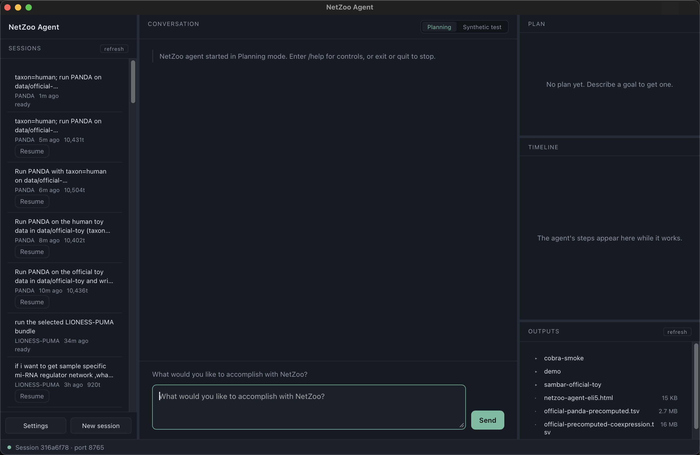

# NetZoo Agent

An LLM agent that turns a plain-language research request into a validated, reproducible
[netZooPy](https://github.com/netZoo/netZooPy) gene-regulatory-network analysis.

You describe what you want ("build a regulatory network for each patient from this expression
matrix, a TF motif prior and a PPI network"). The agent works out which NetZoo method fits,
checks your files, asks only about what is genuinely missing or ambiguous, shows a plan, and
runs the workflow in Docker after you approve the plan.



## What it can run

13 workflows, each with a versioned spec in [`workflows/`](workflows/):

| Workflow | What it produces |
|---|---|
| PANDA | Aggregate TF → gene regulatory network from expression, motif prior and PPI |
| PUMA | PANDA extended with microRNA regulators |
| LIONESS-PANDA / LIONESS-PUMA | One regulatory network per sample |
| LIONESS co-expression | One co-expression network per sample |
| LIONESS-DRAGON | One partial-correlation network per sample across two omics layers |
| DRAGON | Partial-correlation network across two omics layers |
| BONOBO | Sample-specific co-expression networks |
| CONDOR | Communities in a bipartite (e.g. TF–gene) network |
| COBRA | Covariate-aware decomposition of co-expression |
| OTTER | TF → gene network by relaxed graph matching |
| GIRAFFE | TF → gene regulation plus TF activity per sample |
| SAMBAR | Pathway mutation scores and subtypes from somatic mutations |
| PORCUPINE | Pathways whose regulation varies most between patients, from LIONESS sample networks (R package) |

It can also download STRING protein networks (functional, physical or regulatory) for a species.

## How the agent works

- A **planner → executor → evaluator** graph (LangGraph). The plan records, for every input,
  whether you provided it, the agent found it, or it fell back to a default.
- **Fail-closed input checks** before any run: file schema, sample axis, identifier overlap across
  files, and gene IDs checked against NCBI Datasets / Ensembl (cached).
- **Nothing runs without approval.** The agent only plans until you approve the plan for a single
  execution (`/execute` in the terminal, *Execute this plan* in the window).
- **Reasons are tied to the contracts.** When the agent declines or asks a question, the reason
  it states comes from the workflow contracts and checked facts, not from free model text.
- Requests can be written in any language. Replies are always in English.

For the architecture, read [`CODE_READING_GUIDE.md`](CODE_READING_GUIDE.md) first, then
[`NETZOO_HARNESS_ARCHITECTURE.md`](NETZOO_HARNESS_ARCHITECTURE.md).

---

## Quick start

You only need **Docker** and an **OpenRouter API key**. Everything else (Python, netZooPy,
the user interface) is inside the Docker image.

### 1. Install the prerequisites

| Requirement | Where to get it | Notes |
|---|---|---|
| Docker Desktop (macOS / Windows) or Docker Engine + Compose v2 (Linux) | <https://www.docker.com/products/docker-desktop/> | Give Docker about **15 GB of disk**; 8 GB of memory is recommended |
| OpenRouter API key | <https://openrouter.ai/keys> | Billed per token. The default model is `openai/gpt-4o-mini`, one of the cheapest |
| Git | <https://git-scm.com/downloads> | To clone the repository |

Optional keys, which you can add later in `.env`:

- **Tavily** (`TAVILY_API_KEY`): web search for literature and gene lookups.
- **Context7** (`CONTEXT7_API_KEY`): higher rate limits for package-documentation lookups.

### 2. Clone and set up (once)

```bash
git clone https://github.com/Tony90107/Netzoo-Agent.git
cd Netzoo-Agent
./setup
```

`./setup` does the following:

1. Checks that Docker is running.
2. Asks for your OpenRouter key. Input is hidden, and the key is written to `.env` with mode 600.
3. Builds the `netzoo_agent:latest` image, about 6 GB.

The first build takes **tens of minutes**, mostly spent downloading dependencies. Later builds are cached.

### 3. Start the app

```bash
./netzoo-web
```

This starts the agent in Docker. It then opens **<http://localhost:8080>** in your browser,
with a one-time access token in the link. You get the same window as the desktop app: chat,
plan review, option cards, session history and an output browser.

| Command | What it does |
|---|---|
| `./netzoo-web` | Start, or restart, and open the browser |
| `./netzoo-web stop` | Stop the service |
| `./netzoo-web logs` | Follow the agent's output |
| `./netzoo-chat` | The same agent in the terminal instead of the browser |

To try it, type a request such as:

> Run PANDA on the toy data in data/official-toy and save the network to outputs/panda.tsv

### Windows without a Bash shell

`./setup` and `./netzoo-web` are Bash scripts. They work in WSL and Git Bash. From PowerShell,
run the same steps by hand:

```powershell
git clone https://github.com/Tony90107/Netzoo-Agent.git
cd Netzoo-Agent
copy .env.example .env        # then open .env and set OPENROUTER_API_KEY
docker compose build netzoo
docker compose up -d netzoo-web
docker compose logs netzoo-web   # copy the "NetZoo web UI: http://localhost:8080/#token=..." link
```

Open the printed link in your browser. Stop the service with `docker compose stop netzoo-web`.

### Updating

```bash
git pull
docker compose build netzoo
./netzoo-web
```

Rebuild after every pull, because the browser UI is built into the image.

---

## Using the agent

- **Your data.** Put your files anywhere inside the repository folder, for example a new
  `mydata/` folder, and mention their paths in your request. The container sees the repository
  folder as `/work`. Relative paths such as `mydata/expression.tsv` work.
- **Outputs.** If you do not give an output path, results go to `outputs/sessions/<session id>/`.
  Each run writes a manifest and a readable execution report next to its results.
- **Toy data.** [`data/`](data/) ships small example datasets for every workflow
  (`data/official-toy`, `data/lioness-toy`, `data/cobra-toy`, `data/sambar-toy`, ...). The agent
  uses them only when you ask for a demo.
- **Options.** When several methods or readings fit, the reply shows an option card. Each option
  says what you get, how it differs from the others, and when to choose it. Pick one, or answer
  in your own words.
- **Sessions.** Each session keeps its own model, tags, notes and outputs. Sessions can be
  resumed, searched and compared side by side.

### Terminal mode

```bash
./netzoo-chat                      # interactive; plan first, then /execute
./netzoo-chat --resume latest      # continue the most recent pending session
```

Inside the chat, `/execute` runs the current approved plan once and `/planning` withdraws that
approval. `/test` enters synthetic-test mode, where unknown gene labels are allowed as test-only.
`/status` and `/help` are also available. Press Ctrl-C to stop a running analysis.

To preview a plan without executing it:

```bash
docker compose run --rm netzoo python scripts/netzoo_agent.py \
  --task "Run PANDA with data/official-toy/ToyExpressionData.txt, data/official-toy/ToyMotifData.txt and data/official-toy/ToyPPIData.txt"
```

### Running a workflow directly, without the agent

The image ships wrapper scripts:

```bash
docker compose run --rm netzoo run-panda \
  -e data/official-toy/ToyExpressionData.txt \
  -m data/official-toy/ToyMotifData.txt \
  -p data/official-toy/ToyPPIData.txt \
  -o outputs/panda_network.txt
```

The other wrappers are `run-puma`, `run-lioness {panda|puma|coexpression}`, `run-condor`,
`run-cobra`, `run-sambar` and `run-porcupine` (see `docs/PORCUPINE_INTEGRATION.md`). Run any of them with `--help` to see its arguments.

---

## Configuration

All settings live in `.env`. `./setup` creates it, and [`.env.example`](.env.example) lists every
variable with a comment.

| Variable | Default | Meaning |
|---|---|---|
| `OPENROUTER_API_KEY` | — | Required |
| `OPENROUTER_MODEL`, `OPENROUTER_ROUTER_MODEL`, `OPENROUTER_SEMANTIC_MODEL` | `openai/gpt-4o-mini` | Models for replies, routing and reading the request |
| `NETZOO_RESPONSE_MODEL_ALLOWLIST`, `NETZOO_ROUTER_MODEL_ALLOWLIST` | gpt-4o-mini | Guard rails that stop a request reaching an expensive model. Widen them on purpose only |
| `NETZOO_MAX_TASK_TOKENS` | 20000–30000 | Token budget per task |
| `NETZOO_WEB_PORT` | `8080` | Port of the browser UI |
| `NETZOO_*` feature flags | see `.env.example` | Decision layers, all on by default except `NETZOO_CLARIFY_MENU` |
| `TAVILY_API_KEY`, `CONTEXT7_API_KEY`, `NCBI_API_KEY` | empty | Optional lookups |

The agent was developed and evaluated with `gpt-4o-mini`. Other models can work, but they are untested.

## Optional: the native desktop app (macOS)

The browser UI and the desktop app run the same front-end code. If you prefer a native window,
install Node.js 20+ and Rust, then run:

```bash
./setup --desktop
open "desktop/src-tauri/target/release/bundle/macos/NetZoo Agent.app"
```

The app starts and stops the agent container by itself. Keep it inside the repository folder,
because it finds `docker-compose.yml` by walking up from its own location. It is built locally,
not downloaded, because a locally built app is not quarantined by Gatekeeper. Only macOS on
Apple Silicon has been tested. Tauri can also produce Linux and Windows bundles, but they are
untested.

---

## Known limitations

Deliberate trade-offs, unverified assumptions and known gaps are listed in
[docs/KNOWN_LIMITATIONS.md](docs/KNOWN_LIMITATIONS.md).

## Troubleshooting

| Symptom | Fix |
|---|---|
| `Docker is not running` | Start Docker Desktop and wait until it reports *running* |
| The build fails or is killed | Raise Docker's memory limit (Settings → Resources) to 8 GB or more |
| Page says *opened without its access token* | Open the full link that `./netzoo-web` printed (it ends in `#token=...`) |
| Page says *did not accept this page's token* | The service restarted. Use the new link from `./netzoo-web` |
| Port 8080 is already in use | Set `NETZOO_WEB_PORT=8090` in `.env` and run `./netzoo-web` again |
| `OPENROUTER_API_KEY` errors | Check `.env`, then restart with `./netzoo-web` |
| Anything else | `./netzoo-web logs`, or run `/doctor` in `./netzoo-chat` |

## Repository layout

```
scripts/netzoo_agent_core/   the agent: request reading, planning, input checks, execution, replies
scripts/netzoo_agent_core/server/   local daemon behind the browser and desktop UI
scripts/workflow_registry.py the single registry of workflows, inputs and executors
workflows/                   versioned YAML contract for each workflow
AGENTS.md                    project policy (front matter validated at start-up)
desktop/                     the user interface (React + Vite; Tauri shell for the native app)
docker/                      workflow wrapper scripts installed into the image
data/                        toy and test datasets
tests/                       unit, replay and integration tests
```

## Running the tests

```bash
docker build -f Dockerfile.test -t netzoo_agent:test .
docker run --rm -v "$PWD":/work -w /work \
  -e PYTHONPATH=/work/scripts:/opt/netZooPy:/opt/netzoo-harness \
  netzoo_agent:test python -m pytest -q tests
```

Front-end tests: `cd desktop && npm ci && npm test`.

Comments in the code sometimes cite a research-log entry (`docs/research-log/...`). Those logs
are the author's experiment records and are not part of this repository.

## Data preparation note

PANDA and PUMA do not take raw sequencing reads. Expression data must first be preprocessed:
QC, alignment or pseudo-alignment, quantification, gene-ID mapping, filtering and normalisation.
The result should be a gene × sample expression matrix. The agent can transpose sample × gene
tables and skip leading annotation lines, and it writes PANDA/PUMA-compatible TSV.
