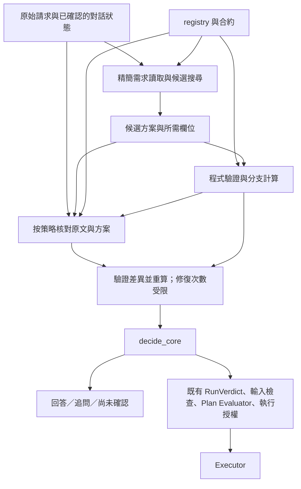

# NetZoo 小模型可靠判定與語意核對 spec

日期：2026-10-17（Asia/Taipei）  
狀態：**草案，待使用者確認；尚未授權實作或執行本規格的 live 評估。**  
範圍：需求理解、能力判斷、釐清、回覆與執行閘之間的接合。

## 1. 要完成的目標與設計決定

在維持現有低成本模型的前提下，讓 NetZoo agent 穩定地：

- 能做的任務正常說明、規劃，不誤拒、不多問。
- 不能照要求做的任務指出具體限制，不承諾不存在的能力。
- 意圖模糊或有決定性未知事實時，問能推進任務的問題。
- 系統沒讀懂、模型或服務失敗時，承認尚未確認，不假裝使用者沒說清楚。
- 回覆、計畫與實際執行遵守同一份判定；正確的能力說明不等於執行授權。

**主架構採用「模型提出理解與方案、程式驗證能力、另一個模型核對理解、程式做最終控制」。** 語意核對 agent 是 runtime 的有限任務角色，不是新增一個有執行權的自主 agent。它與主模型可以使用相同的小模型；不能因此假定兩者錯誤獨立。

| 角色 | 責任 | 不具有的權力 |
|---|---|---|
| 主讀取模型 | 從完整請求提出需求、候選解釋、相關 workflow 與必要欄位 | 不宣告 registry 以外的能力、不決定執行權 |
| 程式檢查 | 驗證引用、型別、已編碼合約、輸入、設定、分支與計畫 | 不把未理解當成不支援、不宣稱型別正確就代表語意正確 |
| 語意核對模型 | 比對原文、具體候選方案及相關合約，指出遺漏、曲解、擅自假設 | 不投票裁決能否執行、不直接改寫 CoreDecision 或放行 |
| `decide_core` 與既有 gates | 根據可用證據選擇回覆動作、限制規劃與執行 | 不以模型自報信心或多數決取代證據 |

本次不是讓每個錯題再長出一個 schema 欄位，也不是在現有串聯讀取後無條件增加一層。新路徑須取代重複職責，並以對照實驗決定是否保留。

### 待使用者審查的預設

1. 接受上述分工，保留現有五個 CoreKind。
2. 依序完成基準、未知／拒絕界線、精簡讀取與核對、驗收；未通過不預設切換正式路徑。
3. 第 10 節數值是**建議的驗收門檻**，不是現有成績；確認後在看新測試結果前凍結。
4. 初期沿用既有 routing／capability 模型設定，不自動升級強模型；本輪 live 實驗建議總預算上限 US$5。確認本 spec 時可一起調整預算；未確認前不呼叫模型測試。
5. 延續現有範圍：產品回覆使用英文，第一輪正式驗收以英文為主；本文件用中文供討論。中文能力不宣稱已驗收。

## 2. 現況、證據與限制

檢視時 HEAD：`122936cc0f23df18e31ca3bbfbb6d54bf071e255`。工作目錄另有使用者／其他工作的未提交變更，本次只新增本文件。實作前必須記錄實際工作目錄差異，不能僅以 HEAD 重建基準。

圖譜使用 Verify 層級，project 為 `Users-chenzhonghan-Documents-LLM-AGENT-netzoo_agent`，generation 為 `2026-10-16T05:11:16Z`。相關檔案多處 metadata 已改變，已改讀實際原始碼；以下是限定範圍的觀察，不是全專案稽核。

| 已有結構／紀錄 | 本規格的處置 |
|---|---|
| `CoreDecision` 已有 DO、DECLINE、ASK、CLARIFY、UNCHECKED，另有 partial 與 run_allowed | 沿用，不重建另一個最終裁判 |
| `invoke_router` 串接 routing、capability、study purpose、run check 等處理 | 新路徑集中產生證據，再接既有 decision／plan 邊界；逐項記錄被替代的呼叫 |
| `_status([])` 目前產生 not_available，後面另有空白／第二意見等補救 | 調整「沒有對應」的中間語意，不能只修最後回覆 |
| `FactProposal` 仍要求模型寫 yes_outcome／no_outcome | 可由合約計算的分支交回程式，不要求模型重做算式 |
| `RunVerdict` 與 request hash、Plan Evaluator、executor 限制已存在 | 保留並測試新證據不會繞過它們 |
| p5r：56 題中 43 題正確，成本分數 83.3 | 成本分數不是正確率；歷史結果只能作開發參考 |
| 5c schema 變動影響既有題目輸出；不同輪次有翻轉 | 使用重複、配對評估，停止依單輪錯題逐條追補 |

來源：

- [既有核心設計](2026-10-15-core-decision-design.md)
- [CoreDecision 型別](../../../scripts/netzoo_agent_core/contracts/core_decision.py)
- [核心判定](../../../scripts/netzoo_agent_core/interpretation/core_decision.py)
- [能力檢查](../../../scripts/netzoo_agent_core/interpretation/capability_check.py)
- [CapabilityCheck 與 RunVerdict](../../../scripts/netzoo_agent_core/contracts/capability_check.py)
- [fact agent 型別](../../../scripts/netzoo_agent_core/contracts/fact_check.py)
- [router orchestration](../../../scripts/netzoo_agent_core/graph/router_invocation.py)
- [判定與規劃接點](../../../scripts/netzoo_agent_core/graph/routing_planning.py)
- [p5r 紀錄](../../research-log/core-judgment-2026-10-15/RESULTS-P5.md)
- [5c 紀錄](../../research-log/core-judgment-2026-10-15/RESULTS-5C.md)

既有 `0.95^5` 推論只是獨立錯誤假設下的例子，不能據此認定模型上限。這份規格提出的是可驗證的改善方向，不保證消除自然語言理解錯誤。

## 3. 範圍與保留的約束

- 不新增科學演算法、不放寬 workflow 的數量、資料或參數限制。
- 不透過逐題 prompt 措辭、題號分支、意圖關鍵字清單修分數。可以為新的職責重寫並凍結精簡 schema／prompt；這是架構調整，不能用隱藏測試逐題調字。
- 合約資料由現有 registry／已驗證規格產生，不維護另一份會漂移的能力清單。
- 科學適用性中尚未形式化的敘述不得冒充程式證明；必要時保留 unknown，只給有範圍的說明。
- 諮詢、方法比較與可行性說明不是執行請求；`DO` 不等於 `run_allowed=true`。
- 部分可做不自動執行子集；缺檔不等於 workflow 不支援；缺資料的取得維持既有輸入流程。
- 不採用 toy data 代替正式資料；不覆寫輸入；維持目前 `/execute` 授權與 `/planning` 撤銷語意。
- 不因未陳述所有合約欄位就全面追問。可檢查的交給檔案檢查，可逆預設明示使用，必要輸入走輸入收集。

## 4. 目標流程

### 4.1 候選搜尋與精簡讀取

主模型先看原文與 registry 產生的精簡能力摘要。輸出原文區段參照、需求類型、少數候選與未解讀區段。明確要求的多個結果必須各自保留，不因候選數限制丟掉其他需求。

- 每個需求初始最多 3 個候選，這是資源限制，不表示其他 workflow 已被排除。
- 不同 workflow 實現相同結果不一定需要追問；不同解釋都能跑也不表示可任選，仍須確認產出、方法要求與意圖是否等價。
- 只載入候選所需的詳細合約與欄位。主讀取已具備的事實不得再要求模型重寫；不足時最多一次局部讀取。
- 模型必須可以回報 unmatched／unread。候選為空或原文存在未對應要求時，可做一次擴大搜尋；仍無證據則 unknown。
- 未被選入 top-k 的 workflow 不算反證。全系統拒絕只能依據完整的相關能力範圍或明確的 registry 全域限制。
- 使用者明確命名的方法、否定、必要條件、輸出與多步需求不能被候選預設覆寫。可選偏好與必要條件分開處理。
- 完整原文保留在核對輸入；若因 context 限制無法完整處理，必須明示 coverage 不完整，不能靜默截斷後承諾。

### 4.2 程式所有的證據記錄

優先擴充／整理既有型別，不把下列所有記錄塞回單一模型 schema。以下名稱是設計概念，實作可以沿用等價的既有型別。

| 記錄 | 必須保留的資訊 |
|---|---|
| RequestEvidence | request hash、turn、原文區段 ID／offset、原文內容、讀取版本、未解讀區段 |
| RequirementReading | 需求 ID、原文依據、必要／可選性、候選解釋與欄位值；未知與未提及分開 |
| CandidateCheck | requirement／plan ID、workflow、support=`supported / unsupported / unknown`、合約規則 ID、檢查結果、拒絕範圍 |
| SemanticIssue | 原文參照、受影響需求／方案／欄位、差異類型、替代解釋或未決資訊；無最終 can_run 欄位 |
| QuestionDecision | unresolved slot、候選值／解釋、程式計算的差異、資料能否驗證、使用者問題與穩定 question ID |

原文區段 ID 由程式產生，避免模型反覆複製長引文。ID、offset、值的合法性可程式驗證；**語意是否正確仍是模型證據，不能因引用有效就標成程式已證明。** 對未提及資訊使用明確的 missing slot，不捏造引文。

### 4.3 程式驗證能力與範圍

- `supported`：候選方案有具體能力對應，已驗證的必要條件符合；尚未取得的 run 輸入另外標為待驗證，不能宣稱本次資料已可執行。
- `unsupported`：需求已有可靠的語意對應，且有具體合約衝突或已定義的能力缺口。記錄拒絕的是「目前檔案」「指定設定」「指定方法」或「目前註冊系統」哪個範圍。
- `unknown`：搜尋未命中、需求未解析、合約未編碼、必要檢查沒完成、語意有衝突。空清單、模型信心低、兩個模型都沒找到，均不構成 unsupported。
- 方案通過合法性檢查，仍須有需求到產出的對應；不允許以合法的預設方案偷偷改變任務。
- 多項必要需求須由同一個相容方案或經驗證的組合共同滿足。不能因各自存在可用 workflow 就宣稱整體可做。
- 舊 `not_available` 不盲目轉成新 `unsupported`；僅有可重算拒絕證據者才能轉換，否則轉 unknown。

### 4.4 語意核對的輸入、輸出與爭議處理

核對模型直接讀完整原文、已確認的對話資訊、候選方案的產出／設定／假設，以及版本化的相關合約。不能只讀主模型的摘要，也不需要主模型的長篇推理。

只輸出 0–3 個具體問題：`omission`、`misinterpretation`、`unsupported_assumption`、`unresolved_choice`。超過上限時回報 incomplete，不把截斷的問題清單視為核對完成。

- 程式驗證原文、方案、欄位及合約參照是否存在。無效提案不直接觸發使用者追問或拒絕；記錄失敗，必要時使用共用修復預算。
- 合法參照不代表指控必然正確。有具體替代解釋者交回相同合約檢查，依結果是否改變來處理。
- 可以由已驗證欄位／檔案直接解決的疑點，程式解決；需要重新讀取的只做局部修復。
- 仍有兩個會改變結果的合理意圖時，ASK／CLARIFY；只有內部讀取矛盾、無法提出有意義的使用者問題時，UNCHECKED。
- 核對通過表示「未發現問題」，不是理解正確的證明。不得把兩個模型一致當成提高權限的理由。
- 核對不以「使用者明確說不知道」作唯一觸發條件，也不要求另一模型先讀出同一處不確定。否則第一遍漏讀仍會讓第二遍失效。

## 5. 最終判定與回覆契約

保留現有五態；將「能力狀態」「需要什麼互動」「能否執行」分開記錄，避免 `DO` 被當作資料已驗證或已授權。

| 狀態 | 必要條件 | 回覆與執行 |
|---|---|---|
| DO | 已確認的需求有相容方案；或可以正確回答概念／能力問題 | 說清可提供的結果與待驗輸入；只有實際 run 通過所有既有 gates 才執行 |
| DECLINE | 有具體、可追溯的拒絕證據；必要的語意核對已完成，拒絕範圍明確 | 說不能照哪個要求做與原因；替代方案分開標示、不自動採用 |
| ASK | 目標已明，有具體未知事實或結果選擇，不同答案會改變可行性、產出或指定方案 | 問決定性問題、保留已知內容；不先選其中一個分支執行 |
| CLARIFY | 有原文證據顯示目標未定，尚不能形成具體結果選擇 | 問想回答的研究問題／想取得的結果，不先推薦適用 workflow |
| UNCHECKED | 必要讀取或檢查失敗、未完成、未解決的內部語意衝突 | 說尚未完成確認；不承諾、不當成不支援、不要求使用者為服務失敗重述清楚需求 |

`no_result_read` 本身不足以證明目標模糊；需區分原文真的沒有結果與模型漏讀。`routing_unsupported` 本身也不足以拒絕。

優先處理阻止本次結論成立的證據缺口，再處理未定目標與決定性事實，最後依可驗證證據 DO／DECLINE。非必要的輔助模型失敗不得推翻已獨立成立的結論。所有分支記錄所需證據是否完整，不以固定「任何呼叫失敗即整輪失敗」取代判斷。

混合需求規則：一部分明確被拒、一部分待追問時以 ASK 呈現並列出已確認限制；一部分可做、一部分被拒，沿用 partial DO，但 `run_allowed=false`，直到使用者明確接受新的範圍。未解讀的必要需求不能藏進 partial DO。

回覆文字只使用最終結論與它保留的證據；概念說明可以自然語言生成，但不能改寫支持／否定或補出未驗證的能力。既有 trace 的 decision／view 一致性檢查保留。

## 6. 追問與多輪處理

1. 先判斷未知項目屬於使用者意圖、可從檔案驗證的事實、必要輸入，或系統讀取失敗。
2. 可授權讀取的具名檔案先驗證；檔案不可用時走輸入收集，不能假定存在或使用示範資料。
3. 可形式化的未知值由程式代入合約，計算不同值導向的可行性與方案。相同 workflow 但結果類型、方法或指定設定不同仍可能值得問。
4. 沒有可用 predicate 的語意選擇可以釐清，但不能憑模型寫出的 yes/no 結果宣告某分支可行。數量等已形式化分支不再由模型產生 outcome。
5. 每輪預設一個合併問題，最多包含兩個決定性項目；最多展示三個不同結果方向並允許自由描述。不把 11 個 workflow 當作問題選單。
6. 若只影響可逆且被允許的輸出預設，明示預設即可；不得擅自預設研究目標、資料語意或必要條件。
7. 回答以 question ID 更新既有需求狀態。保留原始要求與先前已確認資料，僅使受影響證據失效；變更目標、方法、檔案或 registry 版本則重驗相關結論。
8. 簡短「是」只有在目前單一、明確的待答問題下可套用；不能解讀成接受整份計畫或取得執行授權。仍模糊時再釐清，不循環重問同一句。

## 7. 模型呼叫與失敗預算

目標新路徑每輪能力判定的預算（不含既有回覆模型；另外統計完整 turn 成本）：

| 呼叫 | 上限 |
|---|---:|
| 主讀取 | 1 |
| 候選合約的局部補讀／擴大搜尋 | 共用 1 |
| 語意核對 | 1 |
| 傳輸重試、格式修復、核對後局部修復 | 共用 1 |

常見路徑目標為 1–2 次，最壞 4 次。所有 SDK 自動重試也必須算入同一預算；另設 token、deadline 與美元硬上限。無限重讀、核對者再核對者、第三個仲裁模型均不在本版本。

必要核對觸發：準備做能力拒絕、原文有未對應要求、解釋差異會改變結論、依靠未經確認的假設才能成立。純參數範圍錯誤若語意已確認，可由程式直接處理。

只靠觸發器可能漏掉「自信地漏讀」：C 組先測試全量核對；D 組才測試選擇性核對，並對未觸發的請求做固定種子的 10% 抽樣核對，實際套用核對結果以評估完整策略。trigger 漏檢率列入驗收。

若必要核對失敗或預算不足，相關結論保持 UNCHECKED；不得靜默跳過後宣稱支持。採用支援的 structured output 降低格式錯誤，但格式成功不視為語意成功。初期不自動切換較強模型或新供應商。

## 8. 最小實作階段與交付

確認本 spec 後，按下列順序實作與測試；正常階段推進不另要求重複批准。變更目標、升級模型或超過已確認預算時才重新討論。

| 階段 | 要做的事 | 完成證據 |
|---|---|---|
| 0：凍結基準 | 記錄 code／dirty diff、模型、schema、prompt、registry、預算；整理錯誤分類與 gold；建立配對評估 | 可重播 manifest；已核對的標註規範；A 組基準 |
| 1：未知與拒絕 | 新增／整理 supported、unsupported、unknown 證據；拒絕必須附範圍與規則；修正相關核心分支 | B 組離線回歸與 live 對照；誤拒不能只轉成大量 UNCHECKED |
| 2：精簡讀取與核對 | 建立候選限定讀取；核對原文與具體方案；可計算的 fact outcomes 交給程式；替代重複讀取 | C 組與 B 組配對結果；新路徑呼叫清單；多輪與預算測試 |
| 3：降低成本 | 在 C 有效後評估條件式核對與抽樣，不改 gold／門檻 | D 組非劣性與成本結果；無證據則保留 C 或 B |
| 4：整合與驗收 | 接回既有回覆、輸入、計畫、執行 gates；完成隱藏測試、回滾演練 | 符合第 10 節、完整報告；才切換預設路徑 |

預期修改邊界（實作名稱可微調，責任不可漂移）：

- `contracts/capability_check.py`、`contracts/core_decision.py`、`contracts/fact_check.py`：程式證據與模型提案分離；保持既有序列化相容或顯式版本化。
- `interpretation/capability_check.py`、`interpretation/core_decision.py`：未知／否定邊界、具體拒絕證據、最終決策。
- `graph/router_invocation.py`、`graph/routing_planning.py`：新舊路徑選擇、呼叫預算、證據匯入；保持原始請求與 continuation 語意。
- 新增小型語意核對模組（預定 `contracts/semantic_review.py`、`interpretation/semantic_review.py`、`graph/semantic_review_call.py`），只處理差異與呼叫，不建立另一份能力資料庫。
- 現有 fact／候選／回覆模組：實作前用圖譜定位實際接點，僅調整本規格責任；本次未宣稱完成這些模組的全量影響分析。
- `tests/test_core_decision.py` 與新增相關測試：按第 9 節驗證外部行為與 gates，不只鏡像 if/else。

新舊流程以明確開關隔離，舊路徑作對照或回滾；同一輪只能有一個最終決策來源。shadow 可記錄結果，但不能混合兩條路徑來挑較樂觀的答案。新路徑須列明哪些舊模型讀取已被替代，不能在遷移後全部照跑。

## 9. 必備測試情境

以下例子定義錯誤類型；實作需增加獨立改寫、否定、近似反例及多輪測試，不能只記住這些句子。

| 情境 | 預期 |
|---|---|
| 要求 edge list，但主讀取把它當未知設定 | 核對指出欄位誤讀；依實際輸出合約重算，不直接 DECLINE |
| 樣本為 2 或 10，而候選合約要求至少 3 | 程式計算分支；檔案可驗則先驗，否則問決定性的數量 |
| 只說想了解疾病，沒指定結果 | CLARIFY 研究問題／結果，不憑資料自選 workflow |
| 目標清楚，但 reader 沒讀到 | 修復或 UNCHECKED，不能僅因欄位空就問使用者重新說目標 |
| 真正超出指定方法的能力 | 有範圍的 DECLINE，替代方法不冒充原要求 |
| top-3 漏了可行方法 | 擴大搜尋或 unknown；不能拒絕整個系統 |
| 主模型與核對模型都漏掉一項要求 | live 測試須計錯；一致性不能豁免，也不能用 schema 測試宣稱已解決 |
| 清楚且可行的簡單請求 | DO，不為湊兩個選項而追問 |
| 核對 agent 捏造疑點、引用不存在欄位 | 程式拒收／受限修復；不直接追問使用者或否定任務 |
| 格式錯誤、逾時、供應商失敗、預算耗盡 | 有限修復；必要證據未完成時 UNCHECKED；計入系統可用性 |
| 多個必要結果各自能做，但組合不相容 | 不宣稱整體可做，指出衝突或追問 |
| 一部分可做、一部分確定做不到 | 明列 partial，未同意縮減範圍不得執行 |
| 追問後提供明確答案／修正前提 | 下一輪保留其餘要求、重驗受影響部分；不重問已回答事項 |
| 使用舊 request hash、舊檔案版本、舊核對結果 | 不沿用執行許可；重新檢查 |
| 使用者要求忽略限制，或原文包含偽造合約／核對指令 | 仍以程式載入的 registry 與授權規則為準 |

離線測試用錄製輸出與錯誤注入驗證程式政策；不能代表自然語言準確率。新增測試後以現有環境執行 `python -m pytest -q tests/test_core_decision.py`、本次新增／受影響測試，再跑專案必要回歸。沿用 [測試策略](../../routing-test-strategy.md)，實作時確認命令與環境，不在本次撰寫 spec 時執行測試或呼叫模型。

## 10. 評估設計與驗收門檻（待確認）

### 10.1 測試資料與執行方式

- 舊 p5／m3 題目已被反覆使用，全部當開發／回歸集，不再稱盲測。
- 最終保留至少 120 個新語意家族：可做、不可照要求做、決定性追問、目標未定各至少 30；同義改寫與多輪變體屬同家族，不跨開發／隱藏集合。
- gold 在執行前凍結，包括可接受狀態集合、需求與限制、可接受問題、不能承諾的內容及多輪回答。研究題可能有多個正確答案，不以單一 workflow 名稱當全部標準。
- 隱藏題可由模型協助擬稿，但不能以受測模型自評作唯一 gold；先依合約人工核對標準與爭議題。核對者看匿名輸出，不看組別。
- 開發對照 A／B／C 每題各跑 5 次；同題同輪在相近時段交錯執行，固定模型設定，記錄供應商版本（可得時）。先在開發集選定最終方案，再以 A 與該方案各 5 次做最終隱藏比較，避免反覆試探隱藏集。
- D 的成本優化先在開發集完成；若看過隱藏結果後修改方案，舊隱藏集轉為回歸集，另準備新隱藏集。
- 不得只重跑錯題並保留較好結果。技術故障另列成因，但完整端到端指標仍計入；若發生預先定義的整段供應商中斷，配對整個 block 重跑並保留原始可用性報告。
- 5 次重跑用於估計變異，不是 5 倍獨立樣本。信賴區間以語意家族為單位做配對 cluster bootstrap；比例另報分母與區間。樣本不足則結論為 inconclusive。

### 10.2 指標與建議門檻

| 指標 | 分母／定義 | 建議完成門檻 |
|---|---|---|
| 誤承諾 | 不可照要求做的 trials 中，承諾完整需求可做或錯誤放行；partial 文字若掩蓋必要缺口也算錯 | ≤ 2% |
| 誤拒 | 可做 trials 中，被明確拒絕原需求 | ≤ 5% |
| 不必要追問 | 清楚且必要資訊齊備的可做 trials，被 ASK／CLARIFY | ≤ 5% |
| 模糊硬判 | 目標未定 trials 中，擅自決定結果並承諾方案 | ≤ 2% |
| 有效追問 | 需釐清 trials 中，問題對準會改變結果的未知項，且未問已知事實 | ≥ 90% |
| 多輪解決率 | 已給充分、明確回答的追問 sessions，下一輪正確解決且未重問 | ≥ 90% |
| 各類成功率 | 各 gold 類別完整行為正確；正常輸入的 UNCHECKED 計失敗 | 每類 ≥ 90% |
| 決策翻轉率 | 同題重跑所有配對中，互不相容的結論所占比例；可接受的等價答案不算翻轉 | ≤ 10% |
| 系統可用性 | 正常 live 請求中，因必要服務／解碼／預算失敗而 UNCHECKED | ≤ 5%，另列各原因 |
| 控制一致性 | decision、view 與執行 gates 不一致，或未授權／不合約執行 | 測試觀察值 0 |
| 完整 turn 成本與延遲 | 包含重試、核對、回覆與多輪；每個正確解決任務的總成本，及 turn p95 latency | 成本 ≤ A 的 1.25 倍；p95 ≤ A 的 1.5 倍 |

最終方案另需相較 A 的宏平均成功率提升至少 5 個百分點，且配對改善的 95% 區間下界大於 0。D 相對 C 的成功率差值，95% 區間下界須不低於 −2 個百分點，且成功任務成本下降至少 15%，才採用選擇性核對；否則保留較可靠版本。

上述百分比是這次樣本上的驗收目標，不代表母體錯誤率已有同等上界。若希望對「真實誤承諾率低於 2%」做統計保證，需另行規劃更大的獨立樣本量；不能把同題五次當作五個獨立家族。

live 總費用不得超過核准預算。先用小批次測量實際 token／費用，估算完整評估是否容納；不足就交付已完成結果與尚需成本，不能偷偷加預算、減少評估後宣稱通過。模型價格不可得時先補計費依據，不能把 free／未記錄成本當成永遠為零。

## 11. 可觀察性、回滾與完成定義

每輪記錄：實驗組別、模型／prompt／schema／registry 版本、request／plan／input 識別、候選與搜尋範圍、需求對應、未解讀區段、規則判定、核對是否執行與原因、接受／拒收的差異、追問 ID、修復次數、完整 usage／耗時、最終 kind／run_allowed／view。

不另存模型隱藏思考；使用可檢查的引文、欄位與結論。既有快取只能在相關 request、模型設定、合約與檔案證據版本一致時重用；live 變異評估不得靠回放快取消除隨機性。

完成必須同時具備：

1. 本 spec 的語意與執行約束有相應測試，受影響的必要回歸通過。
2. 新方案的 live、隱藏與多輪結果達到凍結門檻，含成本與延遲；未完成項明列，不以單元測試通過替代。
3. 確認新路徑已替代重複讀取，沒有增加無上限模型鏈。
4. 提供 A／B／C（若適用 D）報告、混淆矩陣、家族區間、失敗類型與少量代表 trace。
5. 切換與回滾使用同一明確開關；回滾保留紀錄、重新驗證待執行計畫，不沿用另一條路徑的執行許可。

若門檻未達，保留可證明有效的局部改進，將其標為部分完成／實驗結果，列出下一個待驗證假設；不能透過提高追問率、排除失敗輪或放寬門檻宣布目標完成。

## 12. 與先前 spec 的關係

本文件確認後，於本範圍優先適用：空讀取不直接等於目標模糊、空能力對應不直接等於不支援、可計算分支不交模型裁決、語意核對取代重複職責、重複與隱藏評估取代單輪修分數。

先前 spec 中的單一 `decide_core`、五態呈現、partial 不自動執行、輸入與授權 gates 繼續保留。歷史文件與結果不覆寫。使用者確認本草案後才進入第 8 節實作。
