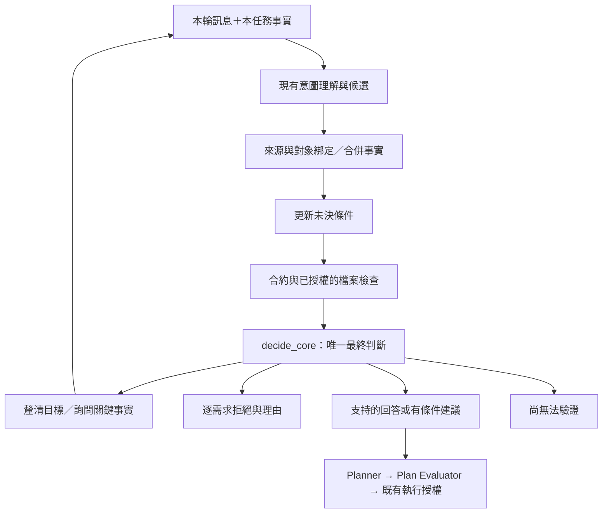

# NetZoo 判斷、追問與記憶修復規格

日期：2026-10-23（同日修訂，見第 15 節）。狀態：**供審閱的設計提案，尚未實作**。

基準：已推送的 `netzoo-agent/main`，凍結系統 `91a8c2d9`（研究紀錄到 `da39e8ac`，含 h6 最後評估）。初稿讀的是 main tree 的 `evidence-contract-grounding` 分支（`dfbcbfd8`）。它比 `netzoo-agent/main` 少 138 個 commit，缺 ROUND-17–22、not-stated fields、keep-legacy-waits 與 h6；第 2 節已依 `91a8c2d9` 改寫。實作在由 `netzoo-agent/main` 建立的 worktree 進行，不在 main tree，因為其他 session 會同時改動 main tree。

保留既有模型與 workflow，改善 harness；本文件不表示已取得新架構的實驗成果。

配套：[分階段實作與驗證計劃](../plans/2026-10-23-evidence-bound-harness-repair.md)。

## 1. 要解決什麼，以及做到哪裡就夠了

目標是讓同一個科學需求，在不同措辭與多輪補充下，仍能穩定得到有根據的回答、拒絕或追問。

最優先的修復是：**沒有提出問題，不等於問題已解決；沒有找到匹配，不等於能力不存在；有引文，不等於推論正確。**

保留現有意圖理解、CoreDecision、Planner、Plan Evaluator 與執行授權。增加可持續保存的未決條件、可核對的合約判定，以及多輪事實更新。先完成可量測的最小版本，再依結果決定是否擴充。

完成的定義有兩層：工程上通過第 12 節的不變條件；研究上完成第 13 節的固定模型比較與誤差分析。研究結果若未改善，仍應如實報告，不能以增加功能或換題代替驗證。

本輪不做：換模型、擴充 workflow、增加向量資料庫、全面改寫意圖抽取、無上限的多 agent 辯論，或將所有 YAML 欄位變成使用者必填表單。

## 2. 已知證據與仍待驗證的問題

| 問題 | 證據等級與來源 | 修復方向 |
|---|---|---|
| fact agent 沒提出任何問題時，解除舊 `needs_fact` | **已在 `91a8c2d9` 修正**（keep-legacy-waits，使用者 10-22 決定）：`waits_after_agent` 只在 agent 有提問時解除。replay 1,171 份讀取：4 份 DO→ASK，0 份對→錯（`docs/research-log/kept-legacy-waits-2026-10-22/`） | 保留，作回歸測試 |
| agent 只要提出任一問題，舊 `needs_fact` 仍整批解除；`without_legacy_waits` 把沒有交付的 wait 改成 `not_available` | `91a8c2d9` 的 `graph/fact_check_call.py::without_legacy_waits`、`waits_after_agent` | 未決條件逐條解除；沒有交付不等於反證 |
| 空 matching 被轉成 `not_available`，可流入 full gap | `interpretation/capability_check.py::_status`、`_full_gap` 確認 | 分開「沒有讀到支持」與「有反證」 |
| result / about_methods / context 分類會改變檢查範圍 | 程式與歷史案例 C14、C24、C44；尚未量出目前整體占比 | 限制綁定需求、workflow、資料與設定，不只依句子類別 |
| 原文核對不保證否定方向、作用對象、條件推論正確 | fact proposal 篩選規則及歷史分支方向錯誤 | provenance 與 entailment 分開；typed rule 判定可重算 |
| 最多兩題之外的候選目前進 rejected | `interpretation/fact_check.py::kept_facts` | 有效但未問到的條件留在 queue，不能被當成不重要 |
| 已有短期 session、workflow continuation、recheck | 本次測試通過；已有 `RequestRequirements` 與 `ConversationState` | 擴充現有狀態，不另建一套平行的對話系統 |
| 長期記憶基本保存與重用已有防護 | 本次 memory/profile/episode 測試通過 | 保留，補資料／規則版本變動時的失效語意 |
| episode 重用階段沒有內容 fingerprint 或 policy hash 比對 | `interpretation/episode_reuse.py`、`contracts/memory.py` | 舊成功只提供候選；本次重新驗證，補驗證 provenance |
| Annotation artifacts | **已有證據**：只看文字的 TF-IDF+LR 在 h5 得 40/48（83.3%），pipeline live 為 68.8%；leave-one-set-out 79–94%（`docs/research-log/text-baseline-2026-10-22/`） | 新題先跑同一基線，另報困難子集 |
| 未見題泛化與多輪語意穩定性 | 部分已知：ROUND-17–22 在看過的題 +43、在新 h5 淨 +2；同一程式重跑約 20% 題目判定翻轉（p4b 對 p4c）。多輪從未量過 | 跨情境拆分；多輪單獨量 |

2026-10-23 本機選取測試：**432 passed，0 failed，0 skipped**；另有 169 deselected。這是在 `dfbcbfd8` 上選取的既有契約測試，不是 432 個真實模型問題的準確率。詳見本機驗證報告（repo 外：`LLM AGENT/output/netzoo-local-test-audit-2026-10-23/report.md`）。`91a8c2d9` 的完整 `tests/` 在 P0 重跑：4,931 passed、51 skipped（[P0 基準](../../research-log/harness-repair-2026-10-23/BASELINE.md)）。

本次無可用 codebase-memory MCP 工具，使用定向原始碼查讀；修訂時以 `git grep`／`git show netzoo-agent/main:` 核對。沒有 graph generation／coverage 或全庫完整稽核的主張。

## 3. 與先前 specs 的關係

沿用 [10/19 混合合約檢查方向](2026-10-19-hybrid-contract-veto-design.md)，不採取精簡 reading 全面取代現行意圖理解的路線。歷史規格與數字保留，不回寫成新設計已經有效。

| 舊規則／設計 | 本提案的明確修訂 |
|---|---|
| fact agent 成功後，舊維度只作 shadow | 保留有有效依據的 obligation；解除要有證據。舊維度可被證明不適用，不能整批刪除 |
| 只有使用者說不確定才提問 | 擴及「未說但對當前決策必須知道」；可用合法預設或可靠檔案檢查解決的，不額外詢問 |
| 附使用者與合約引文即可 veto | 引文是必要來源證據，還需 scope、rule ID、typed operands 與適用性核對 |
| 3 輪仍缺資訊就停止 | 預設最多 **2 輪科學澄清**，保留缺口並暫停；不將未解決改判為不可做 |
| 所有 unknown 都放回原文重讀 | 已確認事實保留；新回答局部 patch，修正時才失效相關依賴 |
| 舊 `CoreDecision` 四種主要狀態＋UNCHECKED | 保留相同外層 kind；新增 per-requirement 判定、hold reason 與澄清進度 |
| 10-21 ROUND-17：同一 run 的設定、規模或要求無法滿足時，`same_run_holds` 連同 run 的可做列也擋下，整題 DECLINE | **使用者 10-23 決定改為 DO + partial**：逐項說明可做與不可做，不自動執行可做的子集；子集要執行，需使用者明確確認修改後的請求。h1–h3 金標 J44、L21、H40、L13（DECLINE）與 a24b MX04／MX05 的衝突依此改判，重標前不拿這些舊金標計分 |
| 10-21 不給錯誤理由（使用者定為最高優先） | 沿用，且優先於本文件其他回覆規則。**使用者 10-23 補充**：每則拒絕都要說理由，不再用制式的 “not matched to any registered workflow”。做法是第 10 節的兩層理由：能核實就說合約理由；不能核實就說查了什麼（引用原文、說明對不到、列出相關的註冊選項），不說未核實的原因 |
| 10-22 追問成本 | 沿用：無必要追問算成本、不算錯誤；主要指標是 FA／FR／MA |
| 10-13 精簡測試、10-11 單一盲標 | 沿用：決策層用離線 replay；live 只跑受影響的題，先報備 session 數與費用；一位盲標員加抽查 |

10/19 已選擇的預設（例如體細胞來源、連續值）不在本文件內悄悄改掉。規格化為 `assumed_default`，記錄原有政策依據與揭露方式；它不是使用者確認的觀察事實。是否足以支持某一執行前提，仍由該 workflow 的明確政策決定，不能以「有預設值」概括放行。預設的研究消融另列，不混入首批修復。

同一批樣本的欄名吻合、網路兩側 ID 不重疊，只能證明檔案層面的性質；不能自動證明生物樣本相同、邊一定具有調控語意。

本文件是對上述差異的提案；實作採用時需同步更新舊 specs 的狀態與變更紀錄。

## 4. 模型與程式的責任

| 模型負責提出 | 程式負責維持與判定 |
|---|---|
| 使用者目的、結果需求、資料／設定的語意讀取 | schema、原文 span、合法 workflow 與欄位驗證 |
| 否定、時間、對象、資料集與需求的可能綁定 | 規則適用範圍、typed 值、數量／組合限制與衝突檢查 |
| 新回答在回答哪個問題、是否更正或換任務 | question ID 對應、狀態 patch、版本／失效與持久化 |
| 尚未形式化的前提、自然語言問句 | 問不問、先問哪個、是否已回答、輪數與執行閘門 |

模型不能以 `confidence`、空清單、自稱「已核實」，直接將未知改成已知。程式也不能僅因字串出現在原文，就宣稱語意已獲證明。

對數字、枚舉與已註冊規則可以作確定性判定；開放語意映射仍有模型錯誤風險。無法可靠綁定時保留 unresolved，允許最多一次有明確失敗原因的局部重讀，並記錄是否新增有效證據。不用第二次模型同意充當形式證明。

## 5. 統一證據與未決條件

以三個小型 code-owned contracts 補足現有 `RequestRequirements`，不要把全部內部欄位一次送給模型。

### 5.1 FactRecord：本次任務已知什麼

必要資訊：`fact_id`、`task_id`、`requirement_id`、`subject_id`（資料集／群組／workflow 對象）、`field`、typed `value`、`revision`、`source_refs`、`supersedes`。

狀態分成兩軸：

- 知識狀態：`unknown | known | conflicted | invalidated`。
- 來源：`user_stated | file_verified | rule_derived | assumed_default | model_proposed`。

`known` 只代表有可用來源，不代表一定符合合約。使用者明說「沒有 motif」是已知事實，不是缺少回答；schema 應以資料可用性 enum 或 boolean 表示，不能用空字串混成 unknown。

來源引用需含 turn ID、原始內容摘要雜湊與 span；保留最小必要原文，使對話壓縮後仍可核對。檔案來源含 artifact revision、validator ID/version 與檢查結果。模型提案先驗證再合併，不能直接更新 authoritative state。

### 5.2 Obligation：還需要知道什麼，為什麼

必要資訊：`obligation_id`、`task_id`、`requirement_id`、`candidate_actions`、`subject_id`、`fact_key`、`rule_id`、`blocking_scope`、`status`、`resolution_ref`。

- `blocking_scope`：影響 feasibility、workflow 選擇／科學含義，或只影響 execution。
- `status`：`open | pending_file_check | resolved | discharged | invalidated`。
- `resolved`：已取得具體事實；仍要判斷該值導向支持或違反。
- `discharged`：具體規則證明此條件不影響剩餘決策，或已不屬於目前需求；不是填入猜測值。
- `pending_file_check`：已排定且有授權、可完成的檢查；不能標成已驗證。

舊 `needs_fact` 經 adapter 轉入，不保留兩套權威狀態。若舊維度疑似錯誤，先檢查來源與作用範圍：可證明不適用則 discharge；讀取失敗則 unresolved，不必強迫使用者回答錯誤問題。

解除義務的合法依據只有：有效新事實、成功檔案檢查、可重算規則推導、經記錄的 scope 變更或決策無關證明。`checked + []`、提案被格式規則丟棄、超過兩題、token 預算耗盡均不構成解除依據。

### 5.3 RuleEvaluation：為何可以或不可以

必要資訊：`rule_id`、`rule_version`、`requirement_id`、`action`、`subject_id`、`fact_refs`、`contract_ref`、`outcome`、`reason_code`。

`outcome = satisfied | violated | unresolved | not_applicable`。合約 reference 含版本／hash、條文 key 與精確引文；引文供人閱讀，判定由已註冊 predicate 及 typed operands 重算。

優先使用現有 registry、workflow conditions、controls、input validators；不複製一份會漂移的能力表。每個新增 predicate 都要能找到對應 workflow 規格。若 policy schema 真有不相容變動，再升 policy version；僅擴充內部狀態不需要任意改 AGENTS policy_version。

## 6. 單一判斷流程與拒絕證據

現行 graph 是 `apply_project_policy → classify → retrieve_memory → plan`。新 task state 必須在 classify 前可用；長期 episode retrieval 維持 classify 後，避免舊任務左右意圖。初版優先在既有 classify／turn 流程接入，不為新名稱額外堆 graph nodes。

每個需求先獨立求 `supported / contradicted / unresolved`，再聚合 CoreDecision：

| 情況 | 判定與行為 |
|---|---|
| 有效證據顯示結果目標多義或尚未指定 | CLARIFY；列結果選項，不能先宣告某 workflow 適合 |
| 重要未知事實會改變可行性、workflow 或科學含義 | ASK；保存 obligation 與 pending question |
| 同一需求已有獨立、充分反證，不同未知答案都不能解除 | 拒絕該需求，不為它追問無關條件 |
| 全部需求有充分反證 | DECLINE；範圍限於本 agent／註冊能力或特定 workflow，不外推「科學上不可能」 |
| 有支持與拒絕，無待決需求 | DO + partial（使用者 10-23 決定）；逐項說明，不能自動執行支持的子集。同一 run 的設定或規模無法滿足時，可做的部分照列，但 run_allowed=false，直到使用者確認不含該設定的請求 |
| 有已拒絕與仍可解決的未知需求 | ASK／CLARIFY，同時呈現已確認的拒絕部分 |
| 模型／解析／必要驗證失敗，沒有足夠判斷依據 | UNCHECKED；不怪使用者問得模糊，不將失敗算成 DECLINE |
| 只有 execution 所需路徑或可檢查條件待完成 | 可有條件回答，但 run_allowed=false，沿用 needs_input／preflight |
| 全部相關條件足以支持當前回答 | DO；仍獨立檢查執行授權與計畫 |

空 matching 必須轉成「未建立支持」，不能直接產生否決；候選規則清單中的正式排除證據仍可構成拒絕。也不能把所有空 matching 自動改為 CLARIFY：有真實目標歧義才問目標；讀取失敗則 UNCHECKED。

讀取成功、但所有需求都對不到任何註冊候選時，kind 維持 DECLINE，以相容既有金標；回覆用第 10 節的第二層理由：引用原文、說明對不到、列出相關的註冊選項。它陳述的是比對結果，不宣稱科學上或能力上做不到。只要有候選而未建立支持，就是 unresolved，不得產生具體限制理由。

對具名 workflow，設定限制也要在 methods question 等分支生效。這不代表把背景提及的所有方法都當成當前要求：先確定 requirement/action scope，再評估規則。若只有一個候選被否決，不能據此拒絕其他候選；全域拒絕需完整的相關候選排除依據或明確的能力邊界規則。

run eligibility 至少要求：非 partial、無執行相關 unresolved/conflict、必要 preflight 完成、目前 fact／input／policy revisions 與 plan snapshot 一致。既有 `/execute`、RunVerdict、Plan Evaluator 與 executor allowlist 都保留；新證據不能替代授權。

## 7. 追問：只問重要的，最多兩輪但不猜答案

### 7.1 問題選擇

依序：目標／結果含義 → 會排除或改變候選的事實 → 執行必須宣告而不能可靠讀檔的條件。明確已給的事實不重問；無關缺漏不問；可逆輸出設定用合法預設並揭露。

每輪一則整合訊息，最多兩個可辨識的子問題。這與 AGENTS 的 consolidated question 一致。每個問題有穩定 `question_id`，綁定 obligation IDs、subject 與答案型別；候選回答優先用 domain enum，避免依賴「yes/no」方向。

程式可驗證的反事實，用同一 rule evaluator 代入各答案比較；連續範圍需依 predicate 的邊界／分段求解，不能只測端點。開放語意問題無可計算 predicate 時，需有可追溯的前提依據，記為未形式化；不能把模型自行寫出的不同 yes/no outcome 當作證明。

問句不得改變預期欄位的意思。已知規則使用模板與合約名稱；自由問句須帶回 obligation 引用，不能取得解除權限。沒輪到的有效問題維持 open／queued，不因 `MAX_ASKED` 被丟棄。

### 7.2 回答與輪數

- 模型產生 `FactPatch`（可併入上述 contracts），列 question ID、fact key、原文、scope、值／更正／不知道；程式驗證再套用。
- 只有一題且答案語意唯一時可對應短答；兩題後只答「yes」，無法唯一對應就不填兩個欄位。
- 明確選項可直接填；自由文字有歧義，僅針對該欄位澄清，不重新解釋全部歷史。
- 使用者同時提供新條件或改目標，保留資訊並進入 scope／dependency 更新，不只擷取預期欄位。
- 預設最多發出兩輪科學澄清（含 goal clarification）；第二輪回答之後仍未解決，停止自動續問。保留 ASK／CLARIFY 與 `clarification_status=exhausted`，顯示缺少資訊與可繼續方式，不宣告不可做、不執行。
- 使用者之後主動補足資訊，仍可更新判斷；重新開始詢問需明確恢復此任務，不因 resume 或換措辭重置輪數。
- 檔案路徑選擇與執行確認沿用原流程，另外計數並報告總互動成本，不能藉分類把無限追問藏起來。

例：CONDOR 的網路種類仍 unknown，fact agent 回傳空清單 → obligation 留存 → ASK。使用者回答「gene–gene」→ 記錄 known 值 → 依當前合約判定。使用者答「不知道」兩輪後 → pending，不把它填成 regulator–gene。

## 8. 任務記憶：保存決策所需事實，而非無限保存全文

擴充 `ConversationState`、`AgentState` 與 session payload，新增 versioned `TaskState`：task ID/revision、需求、facts、obligations、pending questions、clarification count、依賴關係與目前 plan 的 evidence fingerprint。

這是單一 session 中的任務狀態，不是 UserProfile 或 EpisodeStore。純追問回合也必須保存，不依賴是否有 tool results。已確認事實及未決問題不可被 `compact_conversation` 的字數／訊息上限刪掉。

更新規則：

1. 明確更正相同 scope 的事實：舊值 superseded，重算依賴該值的規則；相關 plan／preview／validation 失效，沿用既有 recheck 與本輪授權政策。
2. 新舊陳述衝突，但不確定是否更正、不同資料集或引用背景：標 conflicted；只問衝突部分。不能以最後一句話或模型高信心無條件覆蓋。
3. 換 task 或 dataset：新 task／subject revision。舊 facts 留作歷史，只有使用者明確指涉且 scope 可核對時才能攜入；不自動沿用 sample count、前處理或生物身份。
4. 新資料與先前 file_verified 矛盾：使相關驗證失效並重新查驗；user_stated 不會覆寫客觀檔案結果成已通過，檔案結果也不會證明未能觀測的生物學事實。
5. assistant 自己的回覆不是新的科學證據；歷史摘要／episode 不會變成當前使用者陳述。
6. 舊 session 沒有 TaskState：可讀取與展示，對歷史候選作保守遷移；不可憑助手文字生成已確認 facts，也不可恢復舊執行核准。無法驗證的只重問相關必要部分。

TaskState 的大小有界；可封存已結束任務的詳細事件，但保留當前 confirmed／unresolved 與最小來源。若 active state 超額，明確中止／拆分任務，不能悄悄丟失 blocker。新增 schema 版本與原子寫入；未知未來版本不得當空狀態繼續執行。

## 9. 長期記憶與資料重用

維持 explicit profile confirmation、profile partition、retention、容量限制與刪除。EpisodeStore 用於候選檢索，不承擔本輪 obligation 的真實來源。

每筆可重用輸入補：canonical path、role、dataset/subject、內容 SHA-256、size、validator/version、validated_at、相關 workflow contract hash；policy_hash 繼續記錄。mtime/size 可加速判斷「一定變了」，不能單獨證明「內容沒變」。初版對本次驗證的檔案串流計算 hash，控制額外 I/O。

- 舊 episode 沒 fingerprint：仍可提供路徑候選，但標 unverified，重新驗證與確認；不用一次掃描或重寫所有舊檔。
- 內容、檢查器、相關合約／policy 變更：舊 validation 不可用。本版採保守失效，重新跑目前規則；無關 policy 變更的精細重用留待後續。
- 文件不存在或移動：不以相同檔名自行替代；透過既有 discovery／使用者選擇重新綁定。
- 上次成功不代表本次目標適用；不同 outcome／dataset 的歷史不能自動復用科學結論。
- preview 到 execute 間輸入若變動，invalidate 並重建預覽。至少在 preflight／execute 邊界重驗；若 executor 無法使用同一 snapshot，揭露並發改檔的剩餘限制，不宣稱完全消除 TOCTOU。

`parameters` 目前是名稱清單，不改稱可完整重現的參數紀錄。若研究需要重現，新增受限的 typed parameter snapshot 與版本資訊，依資料治理規則省略憑證等敏感欄位，不擴增任務授權。

## 10. 回覆與可觀測性

所有使用者可見文字維持英文；內部文件可用中文。

- DO：說明支持的需求與必要的條件／預設，不把 pending file check 說成已通過。
- DECLINE／partial：需求 → 限制原因 → 合約依據 → 可行替代。**每則拒絕或不可做的項目都要說理由，分兩層**（使用者 10-23 決定，取代制式的 “not matched to any registered workflow”；10-21 不給錯誤理由規則仍優先於本節其他項）：
  - **第一層：核實的理由。** 理由的每個前提都能由程式對到合約條文（rule ID、條文 key）與使用者原文 span。「沒有任何註冊 workflow 產出 X」這類能力陳述也屬第一層，但要同時滿足三個條件才可用：X 是 registry 的 typed 概念；使用者原文對到 X 的綁定已核實；陳述是對全部註冊 workflow 計算的結果。
  - **第二層：說明查了什麼。** 第一層給不出時使用。它陳述的是比對結果，不是做不到的原因，內容全由程式從 typed 欄位組成：
    1. 逐字引用使用者原文；
    2. 說明這段話對不到任何註冊 workflow 的結果、輸入或設定；
    3. 列出相關的註冊選項：使用者點名了 workflow，就列它的設定或結果；沒點名，就依已讀到的資料類型列 registry 可得的結果；資料類型沒讀到就不列；
    4. 請使用者指出是否其實是指其中一項。

    原文 span 核對不到時不引用，只做 2–4。
  - 兩層都不得使用：模型對條件的判定答案（rule B）、模型自由文字、未核實的能力陳述（例：判斷錯誤時的 “No registered workflow produces this”，live C51），以及未經核對的合約規則。
  - 可行替代只列第一層核實過、或第二層由 registry 列出的選項，並標明是「NetZoo 能產出的」，不是「你要的」；替代方案不能被誤稱完成原需求。
  - 第二層範例（使用者可見文字為英文）：“You asked for ‘…’. I couldn't match that to a result any registered NetZoo workflow produces. From the expression data you described, NetZoo can give: …. Tell me if you meant one of these.”
- ASK／CLARIFY：問必要資訊、簡短說明用途，已確認的資料不重問。
- UNCHECKED／澄清耗盡：區分系統未能驗證與使用者尚未提供事實。

renderer 只呈現同一 CoreDecision 與 per-requirement 證據；UI 卡片／CLI／daemon 不另做 feasibility 判斷。

trace 最少記錄：fact accepted/rejected/superseded、obligation opened/resolved/discharged/deferred、rule evaluated、clarification issued/answered/exhausted、plan invalidated、memory reused/revalidated，以及最終 core/view。每筆含 task/turn/revision 與 evidence refs；不要預設記錄全部資料內容。現有 usage 計量涵蓋新呼叫與局部重讀。

## 11. 最小實作範圍與階段依賴

| 階段 | 交付範圍 | 依賴 |
|---|---|---|
| P0 | baseline manifest、風險案例與 replay fixtures | 無 |
| P1 | Fact／Obligation／RuleEvaluation；移除 checked-empty 整批放行；有效問題排隊 | P0 |
| P2 | 空 matching unresolved；有範圍的拒絕證據；typed contract veto；單一 core 聚合 | P1 |
| P3 | task state、局部回答、更正失效、兩輪限制、resume／壓縮 | P1、P2 |
| P4 | episode freshness、preview／execute 重驗與舊資料相容 | P3 |
| P5 | 固定模型評估、消融、標註品質、論文結果 | 各階段都有 trace；正式評測在候選版本凍結後 |

P1/P2 先用現有流程重現並修正已確認問題，避免等待整個記憶重構才有結果。新增 predicates 先涵蓋現有可執行規則及已記錄失敗類；未覆蓋項目明列 unresolved，不能用 coverage 百分比美化。

## 12. 工程驗收矩陣

以下為新／更新測試要求，**尚未執行**。實際對話例句須由現有合約確認，測試不能同時寫入錯誤生物假設。

| ID | 情境 | 必須觀察到的結果 |
|---|---|---|
| A01 | 關鍵 needs_fact + checked + 空 accepted | blocker 留存；不能因空清單變 DO（`91a8c2d9` 已通過，作回歸） |
| A02 | 所有 fact proposals 被來源／格式規則拒絕；或 agent 只問一題，其餘舊 needs_fact 仍有效 | 有效 obligation 不消失；依剩餘證據 ASK 或 UNCHECKED |
| A03 | 第三個有效必要問題超過本輪容量 | 進 queue；不宣告條件完整 |
| A04 | 可靠新事實／規則證明舊疑問不適用 | 只解除對應 obligation，有 resolution ref，不過度追問 |
| A05 | 正確支持、明確反證、有候選的空 matching、完全無候選、讀取失敗 | 分別得到有據 DO、DECLINE、unresolved、附第二層理由的 DECLINE、UNCHECKED |
| A06 | 同一設定限制換成方法問句或背景敘述 | 當前需求同義時判定不變；純歷史背景不能錯綁 |
| A07 | 引文正確但否定方向／對象／rule operands 不對 | 不能構成 validated veto |
| A08 | 一個需求被拒、另一個可做或需追問；同一 run 的設定不支援 | DO + partial，或 ASK 並列已拒部分；同一 run 時可做部分照列但 run_allowed=false；不能自動執行子集 |
| A09 | 沒說關鍵前提、但沒有「不知道」字眼 | 在無預設／可靠檢查可解決時才問；無關缺漏不問 |
| A10 | 檔案可檢查數量，但不能證明生物身份 | pending file check 與需使用者宣告的事實分開 |
| A11 | 回答一個問題、兩題短答、主動補充新條件 | 只更新可唯一綁定的值；其餘保留 |
| A12 | 更正條件或 dataset／task 切換 | 只失效相關依賴；舊 preview 不可執行，無跨任務污染 |
| A13 | 兩輪未解、resume、多次重開 | 保存 pending 與輪數；無無限追問、猜值或誤拒 |
| A14 | 對話超過 12 訊息／16k 字元再 resume | active facts 與 pending 不被壓縮丟失 |
| A15 | 舊／損壞／未來版本 session | 可解釋的相容或 hold；不恢復無法驗證的核准 |
| A16 | episode 的內容改、路徑同；合約／validator 改 | 舊 validation 失效；現有有效輸入仍可重驗後使用 |
| A17 | preview 後檔案變動 | execute 被阻擋直到新驗證與所需確認完成 |
| A18 | 未授權執行、memory 或 assistant 聲稱已核准 | 不取得操作權限；既有授權測試維持通過 |
| A19 | 舊 episode 無 fingerprints | 保留檢索可用性；不當成當前已驗證 |
| A20 | 同一 frozen evidence 重放 | 決策、理由碼與所引用的證據一致；非決定性欄位除外 |
| A21 | 理由的某個前提無法由程式核對（例：DRAGON 請求裡的 `lambda_inter` 被讀成 `lambda2`，H18） | 不顯示該理由；改用第二層：引用 `lambda_inter`，說明它對不到 DRAGON 的任何設定，列出 DRAGON 的註冊設定 |
| A22 | 任一則拒絕或部分回覆 | 每個不可做的項目都有第一層或第二層理由；第二層的每一句都可由程式重算（引用 span 在原文中、列出的選項都在 registry），不含模型自由文字 |

硬性門檻：選取的必要單元／整合測試無 skipped；所有上述不變條件通過；不增加權限繞過；core/view 矛盾為零；未決義務消失且無原因為零；wrong reason 數不增加（`docs/research-log/reason-accuracy-2026-10-21/` 工具）；不附理由的拒絕為零。這是有限測試集的驗收，不是對所有自然語言的形式保證。

## 13. 研究設計、annotation artifacts 與停止標準

### 13.1 固定變因與比較

固定模型 ID／provider／可控解碼參數／prompt hash／policy hash／程式 commit／資料版本。無法控制的 provider 版本與隨機性如實列出。

- A：目前 baseline（`91a8c2d9`）。
- B：只改未決條件保存。
- C：只改空 matching 與拒絕證據；與 B 共用必要 contract scaffold，但關閉 B 的政策變更。
- D：B + C，含受限 typed contract veto 與 partial 規則。
- E：D + 多輪 task state／memory freshness。

**P1／P2（A–D）只改模型讀取之後的判定，以離線 replay 驗收。** 用 ROUND-13 的 B2 harness（`docs/research-log/stability-round13-2026-10-21/harness.py` 的 `run`／`compare`）重放已錄製的 1,171 份讀取；`91a8c2d9` 在有金標的 757 份中判對 613。replay 結果固定、不花 API 費用，可以逐份列出對→錯與錯→對，與 keep-legacy-waits 的驗法相同。新 contract 若需要舊錄製沒有的欄位，報 incompatible，不補值。

Oracle 分解：模型 reading＋舊 decision、人工核對 reading＋舊 decision、同一模型 reading＋新 decision，分辨讀取／決策／呈現錯誤。

**live 只用在模型讀取有改變的地方**：P3 的更正／換任務辨識、新 prompt 或 schema。replay 無法評估新 prompt/schema 的抽取品質，也不能在狀態分歧後硬套另一條對話的模型輸出，所以多輪（A、D、E）需要 live，使用相同使用者資訊與預先定義的分支回答。關閉防護只用於隔離測試，不用於真實執行。

### 13.2 題目與標註

已看過的題都是開發回歸集：核心 56 題、h1–h6、23 組 heldout、a24b 與 m3 等。新測試集凍結前定義 gold、合理動作集合、決定性事實、作用對象、可接受理由與回答分支；不只標單一 DO／ASK。partial 規則改變後，受影響的舊金標（J44、L21、H40、L13、MX04、MX05）重標並記錄，重標前不拿來計分。

規模依 10-13 的精簡測試規則：

- 開發中：只跑改動影響到的題，每題 1 次，最多約 20 個 session；開跑前向使用者報 session 數與預估費用。
- 最後驗證：一組新寫的約 50 個不同情境（單輪為主，另含補充、更正、換任務、resume、過期記憶的多輪情境），每題跑一次，找共同問題；離線修正後，同一組再跑一次。只有這一步做大回合。
- 費用參考：h6 的 96 個 session 花 US$0.368（約 US$0.004／session）；多輪 session 另估。

題目與標註：

- 同一基礎情境的改寫、最小對比、不同回合不可跨 dev/test；按情境／模板／作者分組。
- 沒有 uncertainty 詞的必要缺漏、帶 uncertainty 詞的無關問題都要有。
- 語序／句型／背景改寫測不變性；只改一個關鍵事實測決策反轉。
- 依 10-11 規則，一位盲於版本與輸出的標註員，加上我抽查決定門檻的 session。論文中明列這是單人標註的限制，不稱雙人驗證。
- 分開「字串／schema／引用合法」與「事實綁定、拒絕理由、追問內容正確」。
- 新題先跑 text-only TF-IDF+LR 基線（`text-baseline-2026-10-22`），另報基線答錯的困難子集。它只用於評估稽核，不作 live gate。

### 13.3 指標與採用門檻

主要指標：false accept（FA，對不支持的要求作出承諾／放行）、false reject（FR，拒絕支持的要求）、missed ask（MA，必要事實漏問）。依 10-22 規則，無必要追問是**成本**，不算錯誤；它與「問了但不是決定性事實」、選錯 workflow 分開報告。另報 wrong reason、不附理由的拒絕數、第二層回覆的誤導數（`reason-accuracy` 稽核另列一類）、兩輪內正確解決率、同題決策翻轉率、UNCHECKED、exhausted、延遲、token 與總互動輪數。

所有指標寫分母。多需求按需求計分並另報整題成功；多輪成功需最終決策與理由正確、途中未錯放行。對等待補充者不可強迫單一最終答案；gold 允許的安全 pending 算適當結果，但不混成「已解決」。區間以獨立情境群聚，不把重複／改寫當獨立樣本。

統計檢定力：同一程式重跑約 20% 題目判定翻轉（p4b 對 p4c）；48 題的題組要錯→對至少 6、對→錯 0，sign test 才達 p<0.05。live 的判定層級比較只看得到大效果，配對差的區間約 ±7–10 個百分點，所以 live 不設百分點非劣門檻。live 結果以描述統計與群聚區間報告；證據不足就如實寫。

採用門檻在跑之前凍結（提案，待審閱）：

1. 工程硬性門檻全通過。
2. replay（P1／P2）：對→錯為 0，或每一份都列出並經使用者決定；FA／FR／MA 不增加；wrong reason 不增加；不附理由的拒絕降為零。
3. 無必要追問的增加量單獨報告，由使用者判斷是否可接受，不自動否決。
4. E 的多輪正確解決率與更正／resume 成功率至少不低於 D，並單獨報告新增成本；不可只挑最好的重複結果。

可以停止擴充的時點：P1–P4 有版本化成果與驗收證據；正式比較、消融與錯誤分析完成；論文主張限於受測工作流／語言／情境。若門檻未過，固定發布範圍、列出剩餘錯誤，不無限加規則或換掉不利題目。碩士論文是否足夠仍由研究貢獻、實驗品質與指導教授／系所要求共同決定。

## 14. 風險與控制

| 風險 | 控制 |
|---|---|
| 保留舊疑問導致過度追問 | 逐條 scope／relevance discharge；新題量測 unnecessary ask，不能保留所有舊維度當真 |
| 新 ledger 成另一套漂移規則 | predicates 來自既有 registry；model proposal、canonical facts、decision 各只有一個權威入口 |
| 第二層列出的選項被誤當成原需求已可完成 | 選項只由 registry 列出，標明是「NetZoo 能產出的」；稽核第二層回覆的誤導數 |
| UNCHECKED 變垃圾桶，表面 false accept 下降 | 報 coverage／UNCHECKED／解決率；replay 逐份列出新增的 UNCHECKED，與無必要追問一樣交使用者判斷 |
| 多一層模型增加延遲與語意錯誤 | 只針對候選與相關條件；至多一次局部重讀；已有可算規則不再呼叫模型 |
| 既有 session／episode 不相容 | schema version、保守 lazy migration、原始檔保留；不得默默清空使用者記憶 |
| 跨回合失效漏接 executor | plan evidence fingerprint；planner、evaluator、executor 各測 snapshot 一致性 |
| 改善只來自題庫風格 | grouped split、最小對比、獨立標註與未見題 |

## 15. 來源與變更紀錄

- 先前完整診斷（repo 外，未納入版本控制：`LLM AGENT/output/netzoo-harness-analysis-2026-10-22.md`）：歷史結果、案例與相關文獻；其中「本機未完成 pytest」已由 10/23 驗證報告補足。
- [10/15 CoreDecision spec](2026-10-15-core-decision-design.md)。
- [10/19 混合 spec](2026-10-19-hybrid-contract-veto-design.md)、[精簡 reading 實驗 spec](2026-10-19-slim-reading-fields-design.md)。
- 10/23 本機測試報告（repo 外：`LLM AGENT/output/netzoo-local-test-audit-2026-10-23/report.md`）。
- [P0 基準](../../research-log/harness-repair-2026-10-23/BASELINE.md)：`91a8c2d9` 的測試、replay、理由與 fixtures 基準。

2026-10-23：根據原始碼、歷史研究與 432 個本機通過測試提出本規格。未實作、未執行新 live 評估、未變更先前實驗結論。

2026-10-23 修訂（使用者審閱後）：

- 基準由 `dfbcbfd8` 改為 `netzoo-agent/main` 的 `91a8c2d9`；第 2 節依此改寫，A01 標為已修正的回歸項。
- partial：採用本文件的 DO + partial（使用者決定），取代 10-21 ROUND-17 的整題 DECLINE；不自動執行子集。
- 沿用 10-21 不給錯誤理由、10-22 追問成本、10-13 精簡測試、10-11 單一盲標；新增 A21 與 wrong reason 門檻。
- 使用者 10-23 決定：每則拒絕都說理由。第 10 節改為兩層理由（核實的合約理由／說明查了什麼），取代 not-matched 制式回覆；完全無候選時用第二層；新增 A22 與「不附理由的拒絕為零」門檻。
- 第 13 節：P1／P2 以 replay 驗收；live 限受影響的題；移除 120 情境×3 次的正式集與 5 個百分點非劣門檻；annotation artifacts 改為已有證據。
